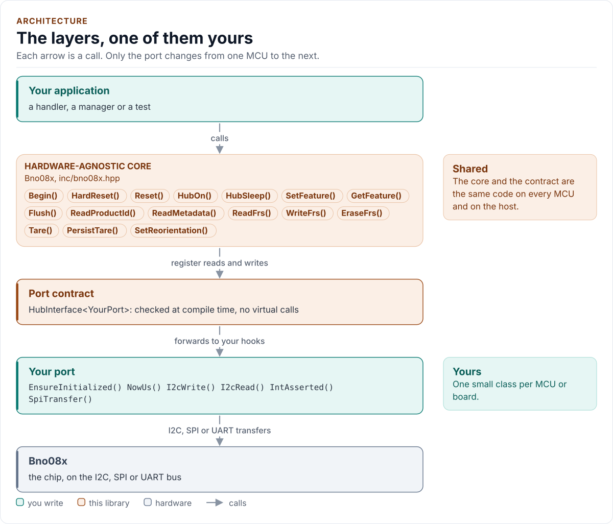
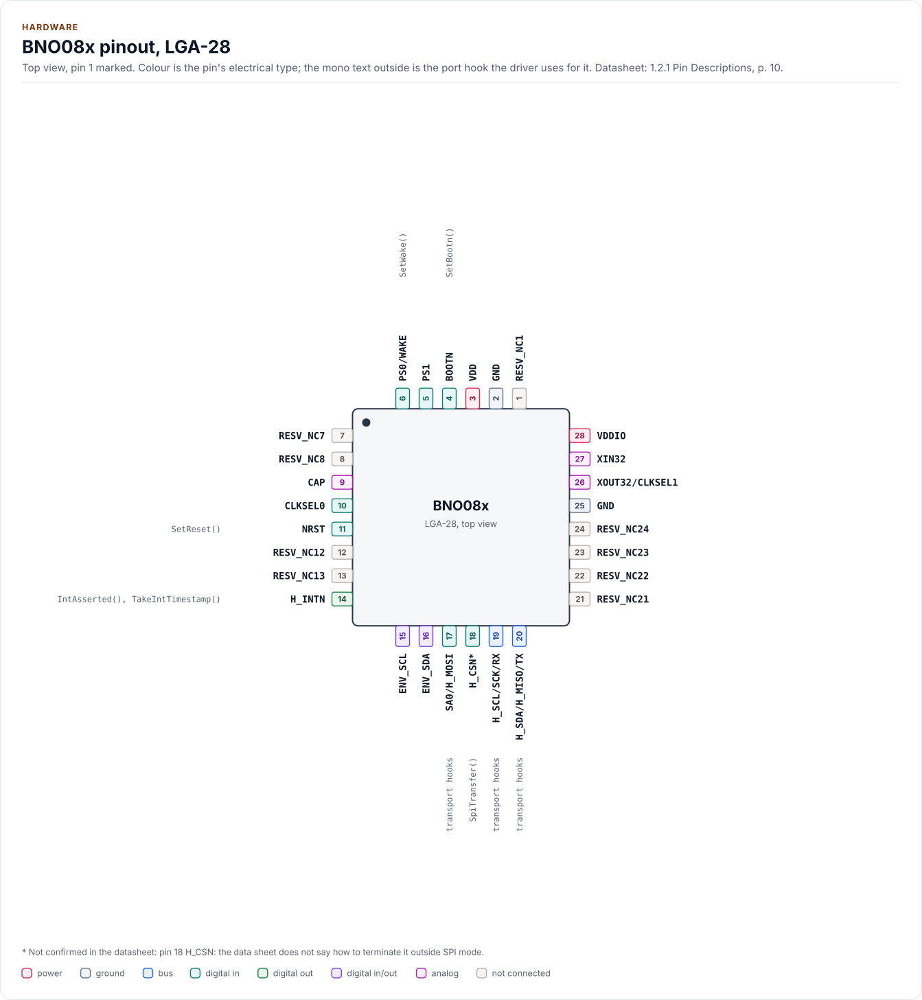
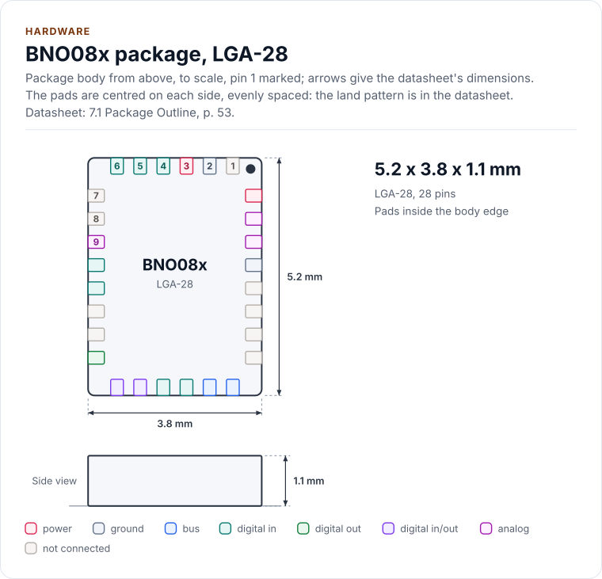
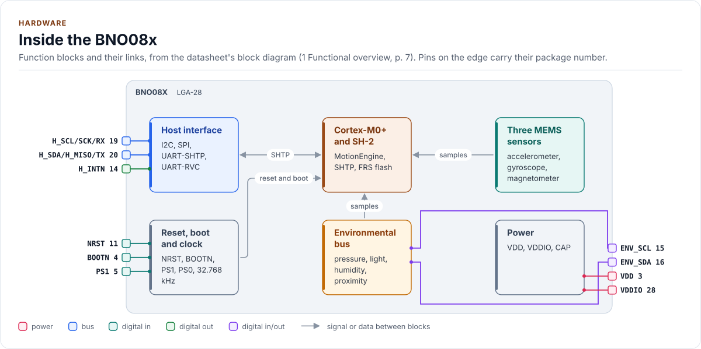

# BNO08X Driver

C++20 driver for the CEVA BNO080, BNO085 and BNO086 smart sensor hubs (SH-2 over SHTP on I2C, SPI and UART, and the
UART-RVC mode).

[](https://github.com/kokeb-labs-drivers/driver-bno08x/actions/workflows/ci.yml)
[](LICENSE)
[](docs/installation.md#requirements)

**Documentation: [`docs/`](docs/index.md)**, with the API reference built by Doxygen ([how](docs/api-reference.md)).
The site at <https://kokeb-labs-drivers.github.io/driver-bno08x/> opens when the repository is public.


The BNO08x family fuses a 3-axis accelerometer, gyroscope and magnetometer inside the chip and reports finished
results: rotation vectors, gravity, linear acceleration, step and activity detection, calibrated and raw sensor
data. This driver starts the hub, speaks SHTP and SH-2 to it over I2C, SPI or UART (or listens to its UART-RVC
stream), keeps a bounded queue of typed events, and turns every framing fault, timeout and restart into a counted
event or an error you can act on. It runs on any MCU: you give it a small class that moves bytes and reads the
interrupt pin, and it does the rest. It is written from the CEVA documents, not by wrapping the vendor library, and
has no firmware update path.

<!-- figure: driver-layers -->
<picture>
  <source media="(prefers-color-scheme: dark)" srcset="docs/diagrams/driver-layers.dark.svg">
  
</picture>
<!-- /figure -->

## At a glance

| | |
| --- | --- |
| **Chip** | BNO080, BNO085 or BNO086 smart sensor hub, LGA-28; you choose the variant, it is not detected |
| **Measures** | Orientation (rotation vectors), acceleration, angular rate, magnetic field, gravity, activity and step detection |
| **Transports** | I2C (0x4A or 0x4B), SPI with H_INTN and WAKE, UART with SHTP framing, and UART-RVC |
| **Also drives** | NRST and BOOTN when your port has `SetReset()` and `SetBootn()`; reads H_INTN |
| **Driver** | Header-only C++20; no heap, exceptions, RTTI or virtual calls; non-blocking `Begin()` and `Poll()`; events from a bounded queue |
| **Runs on** | Any MCU with a bus or UART and a C++20 compiler; the host examples run on any PC ([Platforms](docs/platforms.md)) |
| **Status** | 0.1.0, not yet verified on hardware: host-tested against an independent model of the hub on every transport |

<!-- figure: chip-pinout -->
<picture>
  <source media="(prefers-color-scheme: dark)" srcset="docs/diagrams/chip-pinout.dark.svg">
  
</picture>
<!-- /figure -->

<!-- figure: chip-outline -->
<picture>
  <source media="(prefers-color-scheme: dark)" srcset="docs/diagrams/chip-outline.dark.svg">
  
</picture>
<!-- /figure -->

<!-- figure: chip-blocks -->
<picture>
  <source media="(prefers-color-scheme: dark)" srcset="docs/diagrams/chip-blocks.dark.svg">
  
</picture>
<!-- /figure -->

<!-- generated: chip-card -->
| | | Datasheet |
| --- | --- | --- |
| **Package** | LGA-28 | 1.2.1, [p. 10](https://www.ceva-ip.com/wp-content/uploads/BNO080_085-Datasheet.pdf#page=10) |
| **Pins** | 28 | 1.2.1, [p. 10](https://www.ceva-ip.com/wp-content/uploads/BNO080_085-Datasheet.pdf#page=10) |
| **Body size** | 5.2 x 3.8 x 1.1 mm | 7.1, [p. 53](https://www.ceva-ip.com/wp-content/uploads/BNO080_085-Datasheet.pdf#page=53) |
| **Supply VDD** | 2.4 V to 3.6 V | 6.2, [p. 45](https://www.ceva-ip.com/wp-content/uploads/BNO080_085-Datasheet.pdf#page=45) |
| **Supply VDDIO** | 1.7 V to 3.6 V | 6.2, [p. 45](https://www.ceva-ip.com/wp-content/uploads/BNO080_085-Datasheet.pdf#page=45) |

From [`docs/hardware.yml`](docs/hardware.yml); pins, circuits and the block diagram: [Hardware](docs/hardware.md).
<!-- /generated -->

## Datasheet

<!-- generated: datasheet-card -->
| Document | Revision | Get it |
| --- | --- | --- |
| Datasheet: BNO080/BNO085/BNO086 data sheet (CEVA 1000-3927) | 1.17, 2023-07-24 | [PDF](https://www.ceva-ip.com/wp-content/uploads/BNO080_085-Datasheet.pdf) · [vendor page](https://www.ceva-ip.com/wp-content/uploads/BNO080_085-Datasheet.pdf) |
| Datasheet: BNO080/BNO085 data sheet (earlier revision, history only) (CEVA 1000-3927) | 1.8, 2020-02-05 | [PDF](https://xdevs.com/doc/CEVA/BNO080_085-Datasheet.pdf) · [vendor page](https://xdevs.com/doc/CEVA/BNO080_085-Datasheet.pdf) |
| Datasheet: BNO080 data sheet (earliest revision) (CEVA (Hillcrest Labs) 1000-3927) | 1.3, 2017-10-01 | [PDF](https://cdn.sparkfun.com/assets/b/e/e/7/4/BNO080.pdf) · [vendor page](https://cdn.sparkfun.com/assets/b/e/e/7/4/BNO080.pdf) |
| Datasheet companion, reference manual: SH-2 Reference Manual (CEVA 1000-3625) | 1.9, 2021-06-10 | [PDF](https://www.ceva-ip.com/wp-content/uploads/SH-2-Reference-Manual.pdf) · [vendor page](https://www.ceva-ip.com/wp-content/uploads/SH-2-Reference-Manual.pdf) |
| Datasheet companion, reference manual: SH-2 Reference Manual (earlier revision, history only) (CEVA (Hillcrest Labs) 1000-3625) | 1.2, 2017-05-19 | [PDF](https://cdn.sparkfun.com/assets/4/d/9/3/8/SH-2-Reference-Manual-v1.2.pdf) · [vendor page](https://cdn.sparkfun.com/assets/4/d/9/3/8/SH-2-Reference-Manual-v1.2.pdf) |
| Datasheet companion, protocol: Sensor Hub Transport Protocol (SHTP) (CEVA 1000-3535) | 1.10, 2021-06-10 | [PDF](https://www.ceva-ip.com/wp-content/uploads/Sensor-Hub-Transport-Protocol.pdf) · [vendor page](https://www.ceva-ip.com/wp-content/uploads/Sensor-Hub-Transport-Protocol.pdf) |
| Datasheet companion, protocol: SH-2 SHTP Reference Manual (CEVA 1000-3600) | 1.6, 2019-01-01 | [PDF](https://www.ceva-ip.com/wp-content/uploads/SH-2-SHTP-Reference-Manual.pdf) · [vendor page](https://www.ceva-ip.com/wp-content/uploads/SH-2-SHTP-Reference-Manual.pdf) |
| Datasheet companion, application note: BNO080/BNO085 calibration guide (CEVA 1000-4044) | 1.6, 2023-02-01 | [PDF](https://www.ceva-ip.com/wp-content/uploads/BNO080-BNO085-Sesnor-Calibration-Procedure.pdf) · [vendor page](https://www.ceva-ip.com/wp-content/uploads/BNO080-BNO085-Sesnor-Calibration-Procedure.pdf) |
| Datasheet companion, application note: BNO080/BNO085 calibration procedure (earlier revision) (CEVA 1000-4044) | 1.3, 2019-07-01 | [PDF](https://xdevs.com/doc/CEVA/BNO080-BNO085-Sesnor-Calibration-Procedure.pdf) · [vendor page](https://xdevs.com/doc/CEVA/BNO080-BNO085-Sesnor-Calibration-Procedure.pdf) |
| Datasheet companion, application note: BNO085/BNO086 tare usage guide (CEVA 1000-4045) | 1.3, 2023-02-01 | [PDF](https://www.ceva-ip.com/wp-content/uploads/BNO080-BNO085-Tare-Function-Usage-Guide.pdf) · [vendor page](https://www.ceva-ip.com/wp-content/uploads/BNO080-BNO085-Tare-Function-Usage-Guide.pdf) |
| Datasheet companion, application note: BNO080/BNO085 migration guide (from the BNO070) (CEVA (Hillcrest Labs) none printed) | 1.6, 2017-10-01 | [PDF](https://www.ceva-ip.com/wp-content/uploads/BNO080-BNO085-Migration-Guide.pdf) · [vendor page](https://www.ceva-ip.com/wp-content/uploads/BNO080-BNO085-Migration-Guide.pdf) |
| Datasheet: FSP200 data sheet (same SH-2, read for context only) (CEVA 1000-4121) | 1.5, 2022-09-01 | [PDF](https://datasheet.sic-components.com/FSP200-Datasheet.pdf) · [vendor page](https://datasheet.sic-components.com/FSP200-Datasheet.pdf) |
| Datasheet: BMF055 data sheet (same silicon; electrical limits cross-check only) (Bosch Sensortec BST-BMF055-DS000) | 0.4, 2020-11-01 | [vendor page](https://www.bosch-sensortec.com/media/boschsensortec/downloads/datasheets/bst-bmf055-ds000.pdf) |
| Datasheet companion, application note: BNO055 handling, soldering and mounting instructions (mounting cross-check only) (Bosch Sensortec BST-BNO055-HS000) | 1.0, 2015-01-01 | [vendor page](https://www.bosch-sensortec.com/media/boschsensortec/downloads/handling_soldering_mounting_instructions/bst-bno055-hs000.pdf) |

Written against these revisions; the SHA-256 of each file is in [`docs/datasheets.yml`](docs/datasheets.yml). Where each
part of the driver is in the datasheet: [Datasheet map](docs/datasheet.md).
<!-- /generated -->

Every docs page lists the datasheet sections it relies on, and code comments cite the section they implement.

## Try it on your PC

No hardware needed: [`examples/host`](examples/host/README.md) runs the driver against a model of the hub. You need
git, CMake 3.16+ and a C++20 compiler (GCC 10+, Clang 13+ or MSVC 2022).

1. Get the source:

   ```bash
   git clone https://github.com/kokeb-labs-drivers/driver-bno08x.git && cd driver-bno08x
   ```

2. Build and run the example:

   ```bash
   cmake -S examples/host -B build-example
   cmake --build build-example
   ./build-example/bno08x_example_i2c_quickstart
   ```

3. You should see the driver start the simulated hub and print the angles (the model produces arbitrary data):

   ```text
   enable rotation vector: ok
   yaw 71.87 pitch 2.70 roll 22.56 deg (accuracy 3)
   ```

Ten more programs show SPI, UART, UART-RVC, calibration, tare, batching, records, metadata, the step counter and
fault tolerance. To run the whole test suite instead: `cmake -S . -B build -DBNO08X_BUILD_TESTS=ON && cmake --build
build && ctest --test-dir build`.

## Use it on your MCU

**1. Wire it** ([Hardware](docs/hardware.md) has every pin, the straps, the timing and the power). For I2C:

| MCU | BNO08x pin | Notes |
| --- | --- | --- |
| I2C SCL | 19 H_SCL | Pull-up to the supply |
| I2C SDA | 20 H_SDA | Pull-up to the supply |
| GPIO input | 14 H_INTN | Active low: a message is waiting |
| GPIO output | 11 NRST | Optional, recommended |
| GND | 5 PS1, 6 PS0, 17 SA0 | I2C, address `0x4A` |
| 3.3 V through 10 k | 4 BOOTN | Must be high at reset |
| 3.3 V | 3 VDD, 28 VDDIO | 100 nF each; 100 nF on pin 9 (CAP) |

**2. Write the port**: a class that names its transport and provides `EnsureInitialized()`, `NowUs()`,
`I2cWrite()`, `I2cRead()` and `IntAsserted()`, about 30 lines on most SDKs. [Porting](docs/porting.md) has the
contract for each transport and a complete example.

**3. Read the rotation vector:**

<!-- generated: quickstart-code -->
```cpp
void RunSensor() {
  static MyPort port;
  static bno08x::Bno08x<MyPort> hub(port); // no I/O yet

  const bno08x::Config cfg{}; // BNO085 on I2C 0x4A
  if (const auto r = hub.Begin(cfg); !r.ok()) {
    std::printf("Begin: %s\n", bno08x::ToString(r.error));
    return;
  }

  bool requested = false;
  for (;;) {
    hub.Poll(port.NowUs()); // every few milliseconds: reads, writes and time-outs all happen here
    if (hub.Ready() && !requested) {
      bno08x::FeatureConfig fc{};
      fc.interval_us = 20000; // 50 Hz
      requested = hub.SetFeature(bno08x::SensorId::RotationVector, fc).ok();
    }
    bno08x::Event e{};
    while (hub.PopEvent(e)) {
      if (e.kind == bno08x::EventKind::Sensor) {
        const auto eu = bno08x::ToEulerCentiDeg(e.v[0], e.v[1], e.v[2], e.v[3]);
        std::printf("yaw %" PRId32 " pitch %" PRId32 " roll %" PRId32 " (centi-degrees)\n",
                    static_cast<int32_t>(eu.yaw), static_cast<int32_t>(eu.pitch),
                    static_cast<int32_t>(eu.roll));
      }
    }
  }
}
```
<!-- /generated -->

`Begin()` starts the session and returns at once; `Poll()` does the rest. Every other call returns
`Error::NotInitialized` until `Ready()` is true, and no call blocks.

## What it does

- Starts the hub: reset, advertisement, initialise handshake, with a bounded wait at every step.
- Frames and reassembles SHTP on I2C, SPI and UART, with strict validation and a counter for every rule broken.
- Enables any sensor report the CEVA documents define, with rate, batching and change sensitivity, and decodes each
  into integers in its own units (rotation vectors convert to Euler angles with integer arithmetic).
- Calibrates and tares: motion-engine calibration, saving and clearing the calibration data, tare, reorientation,
  flash records, and the BNO086's interactive calibration.
- Restores the enabled sensors after the hub restarts, and recovers from a corrupt link by resetting the hub.
- Returns `Result<T>` with an `Error` from every call: no exceptions, no heap, no RTTI, no virtual calls.
- Lists every place the documents disagree and the switch that changes the decision
  ([Ambiguities](docs/ambiguities.md)).

## Add it to your project

Pick the row that matches your build; each is a few steps, and [Installation](docs/installation.md) has the
details.

| Your build | Steps below |
| --- | --- |
| Plain CMake: STM32 (CubeMX), RP2040 (Pico SDK), nRF Connect, a host app | [A](#a-cmake-any-mcu) |
| ESP-IDF | [B](#b-esp-idf) |
| An SDK or OS image that installs libraries | [C](#c-installed-package) |

### A. CMake, any MCU

1. Add the driver as a submodule, pinned to the version you chose:

   ```bash
   git submodule add https://github.com/kokeb-labs-drivers/driver-bno08x.git external/driver-bno08x
   ```

2. In your `CMakeLists.txt`, after `project()`:

   ```cmake
   add_subdirectory(external/driver-bno08x)
   target_link_libraries(my_app PRIVATE bno08x::bno08x)   # brings the headers and C++20
   ```

3. In your code, `#include "bno08x.hpp"`, write the port ([Porting](docs/porting.md)) and build. A first build
   that compiles the quickstart above is the check that the driver is wired in.

### B. ESP-IDF

1. Add the driver under your project's `components/`; ESP-IDF finds it there and names it after the folder:

   ```bash
   git submodule add https://github.com/kokeb-labs-drivers/driver-bno08x.git components/bno08x
   ```

2. In `main/CMakeLists.txt`, list it: `idf_component_register(SRCS "main.cpp" REQUIRES bno08x)`.
3. `idf.py menuconfig` now has a **BNO08x sensor hub** menu (variant, address, buffer sizes, timeouts),
   and `idf.py build` builds the driver with your app. [`examples/esp32`](examples/esp32) is a complete
   project with a port for the board.

### C. Installed package

1. Install it once into a prefix:

   ```bash
   cmake -S external/driver-bno08x -B build-bno08x && cmake --install build-bno08x --prefix /opt/sdk
   ```

2. In your project, with `CMAKE_PREFIX_PATH=/opt/sdk`:

   ```cmake
   find_package(bno08x 0.1 REQUIRED)
   target_link_libraries(my_app PRIVATE bno08x::bno08x)
   ```

The target is `bno08x::bno08x` every way, so switching later changes nothing else.

## Documentation

| Page | Read it when you want to |
| --- | --- |
| [Quickstart](docs/quickstart.md) | Go from a bare chip to the rotation vector on your MCU |
| [Hardware](docs/hardware.md) | Wire it, choose the transport, check the timing and the power |
| [Transports](docs/transports.md) | Understand SHTP over I2C, SPI, UART and the UART-RVC mode |
| [Porting](docs/porting.md) | Write the port class for your MCU's SDK |
| [API guide](docs/api-guide.md) | Use each call: start, enable sensors, read events, handle errors |
| [Sensors](docs/sensors.md) | Find every report, its fields and units |
| [Calibration](docs/calibration.md) | Calibrate, tare and use the flash records |
| [Configuration](docs/configuration.md) | Choose every setting and the buffer sizes |
| [Ambiguities](docs/ambiguities.md) | See where the documents disagree and what the driver decided |
| [Troubleshooting](docs/troubleshooting.md) | Find the cause of an error or a wrong reading |
| [Contract](docs/contract.md) | Know exactly what the driver promises, needs and returns |
| [Datasheet map](docs/datasheet.md) | Find the datasheet section behind each part of the driver |
| [API reference](docs/api-reference.md) | Look up a class or member (Doxygen; built by CI and locally) |

## Tests and quality

```bash
cmake -S . -B build -DBNO08X_BUILD_TESTS=ON && cmake --build build && ctest --test-dir build
```

The host tests run the driver against an independent model of the hub on all four transports, inject bus faults,
corrupt frames and restarts, and produce each error the driver can return. A fuzzer fails, corrupts and replaces what
the hub sends back and checks the driver's promises after every call. CI also builds for Cortex-M and gates coverage,
complexity, sanitizers, fuzzing, clang-tidy, cppcheck and the handbook rules (`.kokeb/handbook.yml`). See
[Testing and CI](docs/testing.md), which lists every gate and its limit.

## License

MIT. See [LICENSE](LICENSE).
