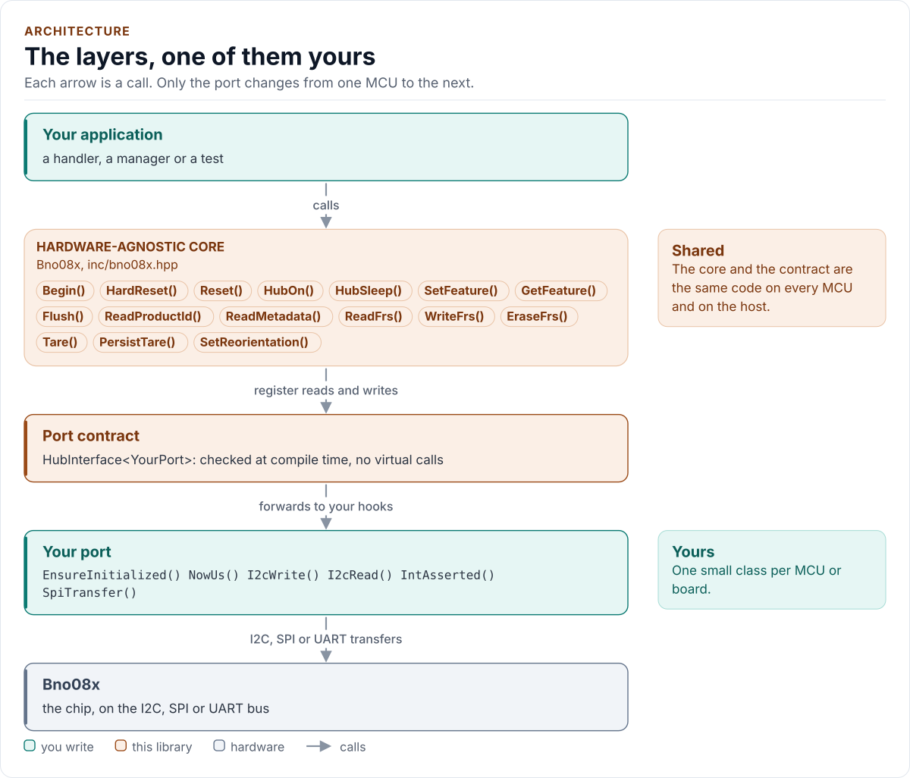
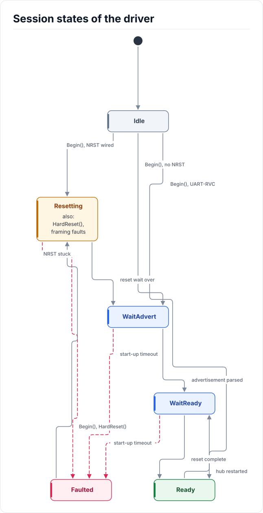
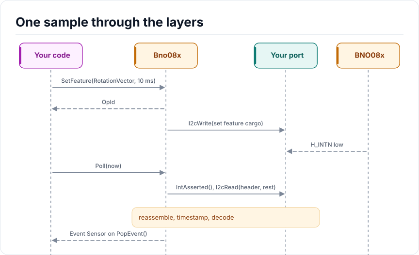

# Architecture

How the driver is built: three layers, one of them yours, and what happens in each when a sample arrives.

<!-- generated: datasheet-refs -->
??? abstract "Datasheet sections this page relies on"

    - SHTP header, channels and cargo reads: CEVA 1000-3927 1.17, 1.3.1 SHTP, [p. 22](https://www.ceva-ip.com/wp-content/uploads/BNO080_085-Datasheet.pdf#page=22)
    - Report structure, product ID, executable commands: CEVA 1000-3927 1.17, 1.3.2 Report Structure, [p. 23](https://www.ceva-ip.com/wp-content/uploads/BNO080_085-Datasheet.pdf#page=23)
    - Getting started: establishing contact and reading: CEVA 1000-3927 1.17, 5 Getting started with BNO08X, [p. 43](https://www.ceva-ip.com/wp-content/uploads/BNO080_085-Datasheet.pdf#page=43)
    - Start-up timing: CEVA 1000-3927 1.17, 6.5.3 Startup timing, [p. 47](https://www.ceva-ip.com/wp-content/uploads/BNO080_085-Datasheet.pdf#page=47)
    - Command request and response: CEVA 1000-3625 1.9, 6.3.8 Command Request (0xF2), [p. 43](https://www.ceva-ip.com/wp-content/uploads/SH-2-Reference-Manual.pdf#page=44)
    - Header, channels and the rules of a cargo: CEVA 1000-3535 1.10, 2.2.1 SHTP Header, [p. 4](https://www.ceva-ip.com/wp-content/uploads/Sensor-Hub-Transport-Protocol.pdf#page=5)
    - Channel advertisement: CEVA 1000-3535 1.10, 5.2 Channel Advertisement, [p. 15](https://www.ceva-ip.com/wp-content/uploads/Sensor-Hub-Transport-Protocol.pdf#page=16)

    All of them, with the driver API for each: [Datasheet map](datasheet.md).
<!-- /generated -->

<!-- figure: driver-layers -->
<picture>
  <source media="(prefers-color-scheme: dark)" srcset="diagrams/driver-layers.dark.svg">
  
</picture>
<!-- /figure -->

## Layers

| Layer | Files | Owns |
| --- | --- | --- |
| Core | [`inc/bno08x.hpp`](../inc/bno08x.hpp), [`src/bno08x.ipp`](../src/bno08x.ipp) | The session state machine, the operation queue, the event queue, timing, errors |
| Protocol | [`inc/bno08x_shtp.hpp`](../inc/bno08x_shtp.hpp), [`inc/bno08x_rvc.hpp`](../inc/bno08x_rvc.hpp) | SHTP framing and reassembly, the UART framing, the advertisement, the UART-RVC frames |
| Definitions | [`inc/bno08x_types.hpp`](../inc/bno08x_types.hpp), [`inc/bno08x_registers.hpp`](../inc/bno08x_registers.hpp), [`inc/bno08x_reports.hpp`](../inc/bno08x_reports.hpp), [`inc/bno08x_records.hpp`](../inc/bno08x_records.hpp) | `Error`, `Result`, `Config`, `Event`, the SH-2 constants, the table of report layouts, the FRS records |
| Port contract | [`inc/bno08x_interface.hpp`](../inc/bno08x_interface.hpp) | The CRTP base, the `HubPort` concept and its transport variants |
| Platform port | Your class | The bus or UART, a clock, H_INTN and optionally NRST, BOOTN, WAKE and logging |
| Helpers | [`inc/bno08x_euler.hpp`](../inc/bno08x_euler.hpp), [`inc/bno08x_kconfig.hpp`](../inc/bno08x_kconfig.hpp) | Integer quaternion to Euler; an optional `Config` from ESP-IDF menuconfig |

## Never blocking

The hub is asynchronous: it sends reports when it likes, answers requests later, and batches. The driver is
therefore a state machine that you run from your loop.

<!-- figure: session-states -->
<picture>
  <source media="(prefers-color-scheme: dark)" srcset="diagrams/session-states.dark.svg">
  
</picture>
<!-- /figure -->

Not drawn, to keep the picture readable: `Begin()` starts again from any state, like from `Idle`. Without NRST,
too many framing faults queue the reset command instead, and the session stays where it is until the hub's
restart arrives (`Ready` to `WaitReady`). A `HardReset()` or framing-fault reset whose pins cannot be driven
leaves the session `Faulted`. In `Faulted` only stop requests are written and nothing read is used.

`Poll(now_us)` reads what the hub has waiting (a transfer per H_INTN on I2C and SPI, the bytes in the UART
receiver), reassembles cargoes, decodes reports into events, writes the next queued request and checks the
timeouts. It never waits on the hub: a port hook that needs time (a stretching bus) is the only thing that can.

## One sample through the layers

<!-- figure: one-sample-through-the-layers -->
<picture>
  <source media="(prefers-color-scheme: dark)" srcset="diagrams/one-sample-through-the-layers.dark.svg">
  
</picture>
<!-- /figure -->

## Design choices

- **CRTP and concepts, not virtual functions.** The port is a template parameter checked by the `HubPort` concept:
  every call resolves at compile time, and a missing or misdeclared hook is a compile error that names it.
- **One class, four transports.** `Port::kTransport` selects the read and write path at compile time; the code of
  a transport you do not use is not instantiated.
- **No I/O in the constructor, no blocking in `Begin()`.** Construction cannot fail, so the driver can be a static.
- **Operations return ids, results arrive as events.** One queue of events carries samples, operation results,
  resets and errors, so the application has one place to look. A full queue drops and counts.
- **Tables, not code, for reports.** Every sensor's layout is one row of a table, checked at compile time; adding a
  report adds a row.
- **Independent model for tests.** The tests run the driver against a model of the hub written separately from the
  driver ([Testing and CI](testing.md)), so a bug cannot hide behind a copied assumption.
- **No heap, no exceptions, no RTTI, no `std::function`, no `printf`.** A header-only template with no mutable
  static state.

## Source map

| You want | Read |
| --- | --- |
| The public API | [`inc/bno08x.hpp`](../inc/bno08x.hpp) |
| How a call is implemented | [`src/bno08x.ipp`](../src/bno08x.ipp) |
| Framing and reassembly | [`inc/bno08x_shtp.hpp`](../inc/bno08x_shtp.hpp) |
| Report layouts and Q points | [`inc/bno08x_reports.hpp`](../inc/bno08x_reports.hpp) |
| The port contract | [`inc/bno08x_interface.hpp`](../inc/bno08x_interface.hpp) |

Next: [Contract](contract.md).
