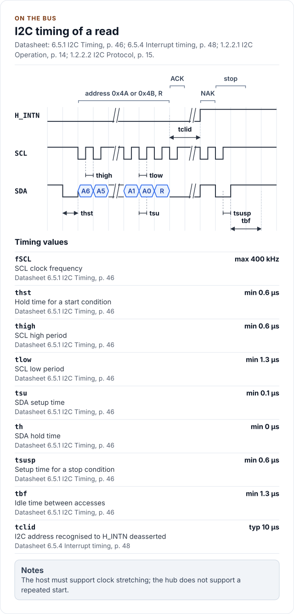
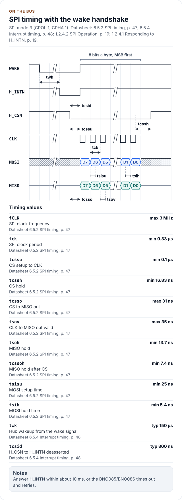
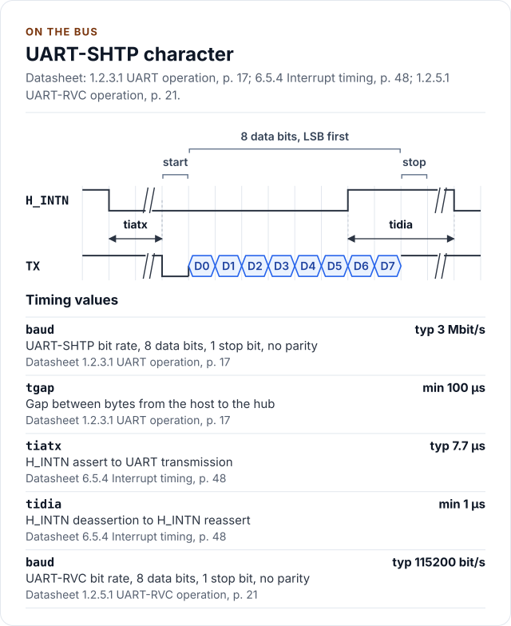
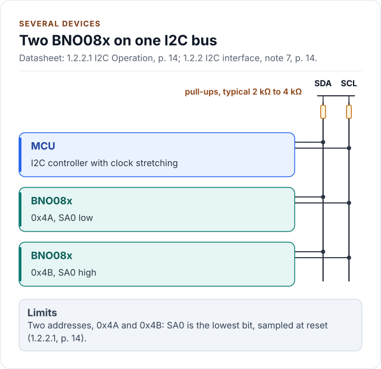

# On the bus

What the BNO08x needs from each bus it speaks, signal by signal, with every time and rate taken from the CEVA data
sheet 1000-3927 revision 1.17. The SHTP framing on top of the bus is on the [Transports](transports.md) page; this
page is the waveform under it.

## I2C

The hub is an I2C slave at up to 400 kbit/s. H_INTN low tells the host a cargo is waiting; the host reads it with a
plain read (no repeated start) and the hub releases H_INTN once it has recognised its address. The host must allow
clock stretching.

<!-- figure: i2c-timing -->
<picture>
  <source media="(prefers-color-scheme: dark)" srcset="diagrams/i2c-timing.dark.svg">
  
</picture>
<!-- /figure -->

## SPI

The hub uses SPI mode 3 (CPOL 1, CPHA 1) at up to 3 MHz. When the host wants to talk first it pulls WAKE (the PS0
pin after reset) low and waits for H_INTN; the hub releases H_INTN as soon as it sees H_CSN low.

<!-- figure: spi-timing -->
<picture>
  <source media="(prefers-color-scheme: dark)" srcset="diagrams/spi-timing.dark.svg">
  
</picture>
<!-- /figure -->

## UART

UART-SHTP runs at 3 Mbit/s, 8 data bits, one stop bit, no parity. The hub pulls H_INTN low shortly before it starts
to send, so the host can time-stamp the message; bytes from the host must be at least 100 µs apart. UART-RVC uses
the same character format at 115200 bit/s and only the hub's TX line.

<!-- figure: uart-timing -->
<picture>
  <source media="(prefers-color-scheme: dark)" srcset="diagrams/uart-timing.dark.svg">
  
</picture>
<!-- /figure -->

## Several devices

The SA0 pin sets the lowest bit of the 7-bit I2C address at reset, so two hubs can share one I2C bus, at 0x4A and
0x4B. The data sheet describes no shared SPI or UART arrangement beyond the usual one chip select per SPI device.

<!-- figure: i2c-topology -->
<picture>
  <source media="(prefers-color-scheme: dark)" srcset="diagrams/i2c-topology.dark.svg">
  
</picture>
<!-- /figure -->

## How these figures are made

Each figure is a model in `docs/model/` (`i2c-timing.timing.yml`, `spi-timing.timing.yml`, `uart-timing.timing.yml`
and `i2c-topology.topology.yml`) that cites the datasheet section and page of every number; `kokeb-docs figures`
draws it and the build fails on a number without a citation. The values table under each waveform is also written as
`docs/diagrams/<id>.table.html`.
