# Figures

<!-- Written by kokeb-docs figures from docs/diagrams/figures/*.py. Do not edit by hand. -->

Every figure on this site is drawn by a Python module from facts extracted from the code, so it is rebuilt,
not redrawn, when the code changes. CI runs `kokeb-docs figures --check` and fails when a
committed figure no longer matches the code. Each figure below lists the files it is drawn from.

## Inside the BNO08x

<!-- figure: chip-blocks -->
<picture>
  <source media="(prefers-color-scheme: dark)" srcset="chip-blocks.dark.svg">
  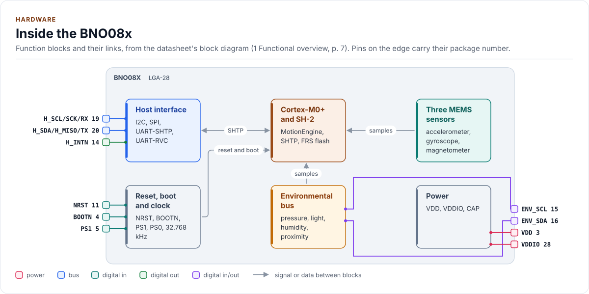
</picture>
<!-- /figure -->

Hardware description: [`docs/hardware.yml`](../hardware.yml)

Drawn from:

- [`docs/hardware.yml`](../hardware.yml)
- [`inc/bno08x_interface.hpp`](../../inc/bno08x_interface.hpp)

## What the BNO08x does

<!-- figure: chip-capabilities -->
<picture>
  <source media="(prefers-color-scheme: dark)" srcset="chip-capabilities.dark.svg">
  
</picture>
<!-- /figure -->

Hardware description: [`docs/hardware.yml`](../hardware.yml)

Drawn from:

- [`docs/hardware.yml`](../hardware.yml)
- [`inc/bno08x_interface.hpp`](../../inc/bno08x_interface.hpp)

## BNO08x: I2C

<!-- figure: chip-circuit-i2c -->
<picture>
  <source media="(prefers-color-scheme: dark)" srcset="chip-circuit-i2c.dark.svg">
  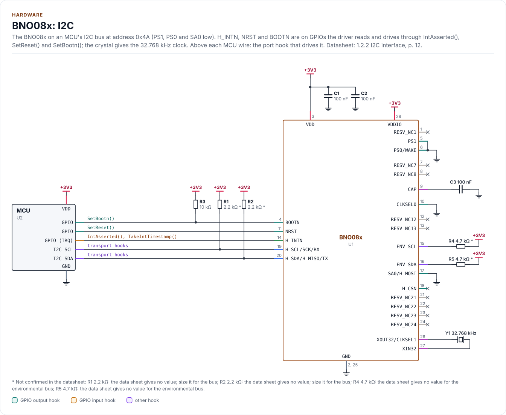
</picture>
<!-- /figure -->

Hardware description: [`docs/hardware.yml`](../hardware.yml)

Drawn from:

- [`docs/hardware.yml`](../hardware.yml)
- [`inc/bno08x_interface.hpp`](../../inc/bno08x_interface.hpp)

## BNO08x: SPI

<!-- figure: chip-circuit-spi -->
<picture>
  <source media="(prefers-color-scheme: dark)" srcset="chip-circuit-spi.dark.svg">
  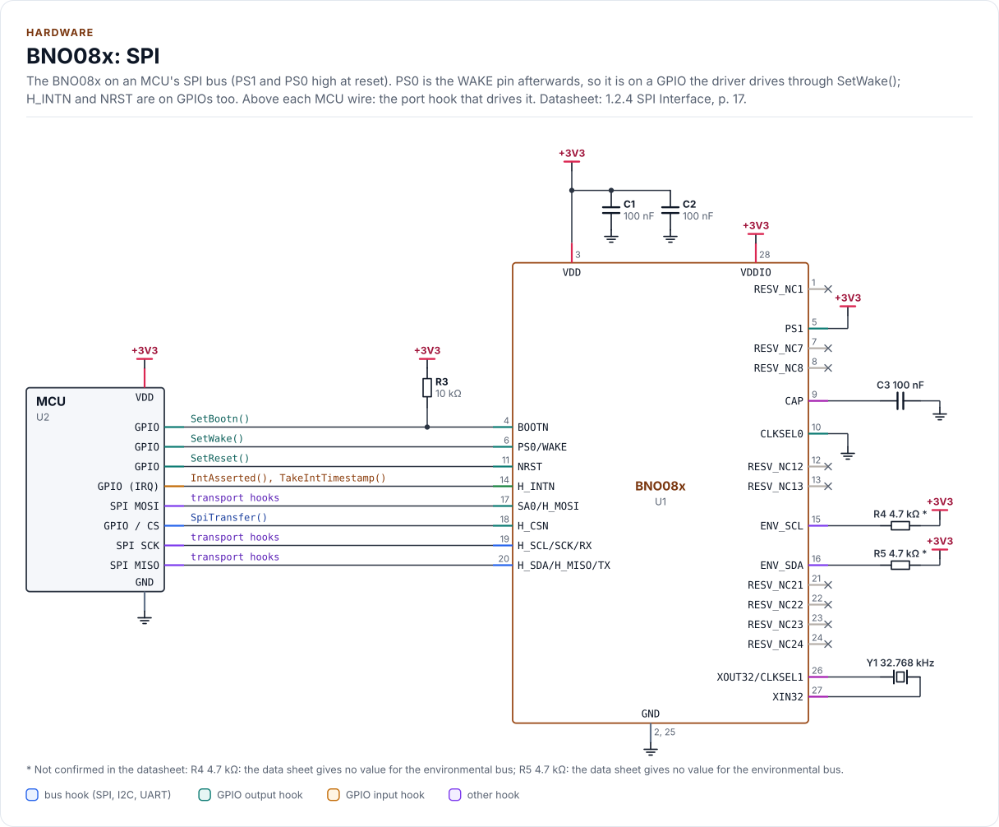
</picture>
<!-- /figure -->

Hardware description: [`docs/hardware.yml`](../hardware.yml)

Drawn from:

- [`docs/hardware.yml`](../hardware.yml)
- [`inc/bno08x_interface.hpp`](../../inc/bno08x_interface.hpp)

## BNO08x: UART-RVC

<!-- figure: chip-circuit-uart-rvc -->
<picture>
  <source media="(prefers-color-scheme: dark)" srcset="chip-circuit-uart-rvc.dark.svg">
  
</picture>
<!-- /figure -->

Hardware description: [`docs/hardware.yml`](../hardware.yml)

Drawn from:

- [`docs/hardware.yml`](../hardware.yml)
- [`inc/bno08x_interface.hpp`](../../inc/bno08x_interface.hpp)

## BNO08x: UART-SHTP

<!-- figure: chip-circuit-uart-shtp -->
<picture>
  <source media="(prefers-color-scheme: dark)" srcset="chip-circuit-uart-shtp.dark.svg">
  
</picture>
<!-- /figure -->

Hardware description: [`docs/hardware.yml`](../hardware.yml)

Drawn from:

- [`docs/hardware.yml`](../hardware.yml)
- [`inc/bno08x_interface.hpp`](../../inc/bno08x_interface.hpp)

## BNO08x

<!-- figure: chip-hero -->
<picture>
  <source media="(prefers-color-scheme: dark)" srcset="chip-hero.dark.svg">
  
</picture>
<!-- /figure -->

Hardware description: [`docs/hardware.yml`](../hardware.yml)

Drawn from:

- [`docs/hardware.yml`](../hardware.yml)
- [`inc/bno08x_interface.hpp`](../../inc/bno08x_interface.hpp)

## BNO08x package, LGA-28

<!-- figure: chip-outline -->
<picture>
  <source media="(prefers-color-scheme: dark)" srcset="chip-outline.dark.svg">
  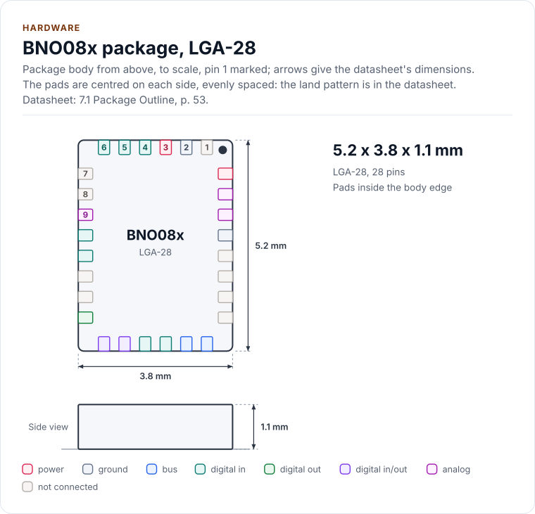
</picture>
<!-- /figure -->

Hardware description: [`docs/hardware.yml`](../hardware.yml)

Drawn from:

- [`docs/hardware.yml`](../hardware.yml)
- [`inc/bno08x_interface.hpp`](../../inc/bno08x_interface.hpp)

## BNO08x pinout, LGA-28

<!-- figure: chip-pinout -->
<picture>
  <source media="(prefers-color-scheme: dark)" srcset="chip-pinout.dark.svg">
  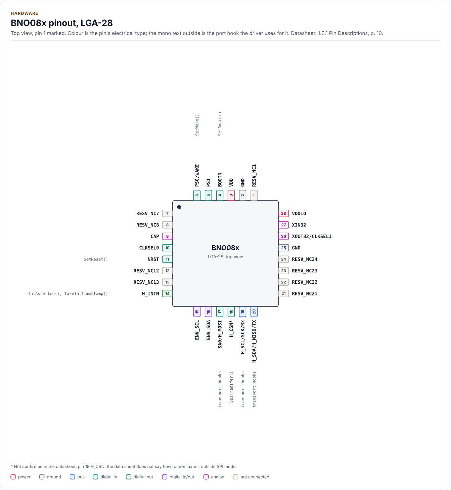
</picture>
<!-- /figure -->

Hardware description: [`docs/hardware.yml`](../hardware.yml)

Drawn from:

- [`docs/hardware.yml`](../hardware.yml)
- [`inc/bno08x_interface.hpp`](../../inc/bno08x_interface.hpp)

## Wiring: I2C

<!-- figure: chip-wiring-i2c -->
<picture>
  <source media="(prefers-color-scheme: dark)" srcset="chip-wiring-i2c.dark.svg">
  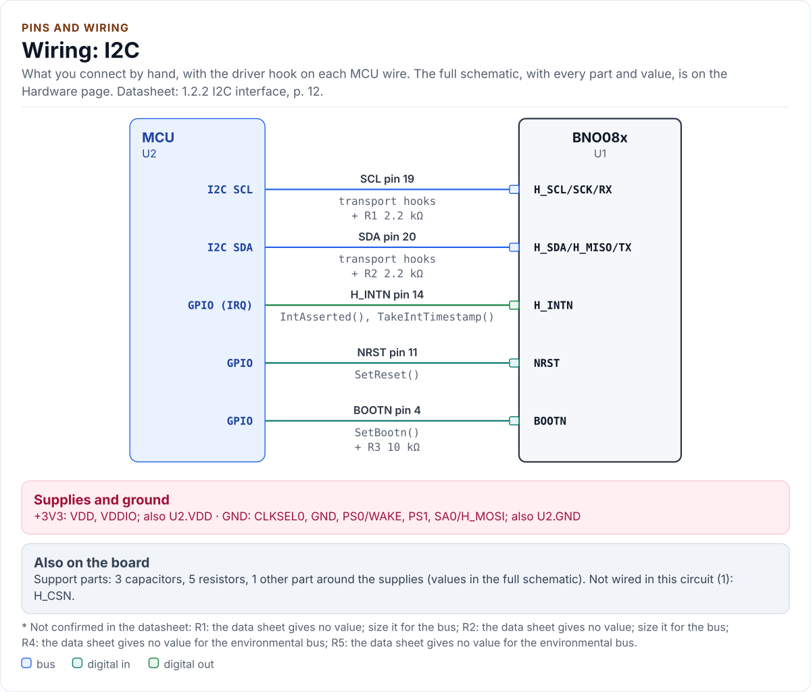
</picture>
<!-- /figure -->

Hardware description: [`docs/hardware.yml`](../hardware.yml)

Drawn from:

- [`docs/hardware.yml`](../hardware.yml)
- [`inc/bno08x_interface.hpp`](../../inc/bno08x_interface.hpp)

## Wiring: SPI

<!-- figure: chip-wiring-spi -->
<picture>
  <source media="(prefers-color-scheme: dark)" srcset="chip-wiring-spi.dark.svg">
  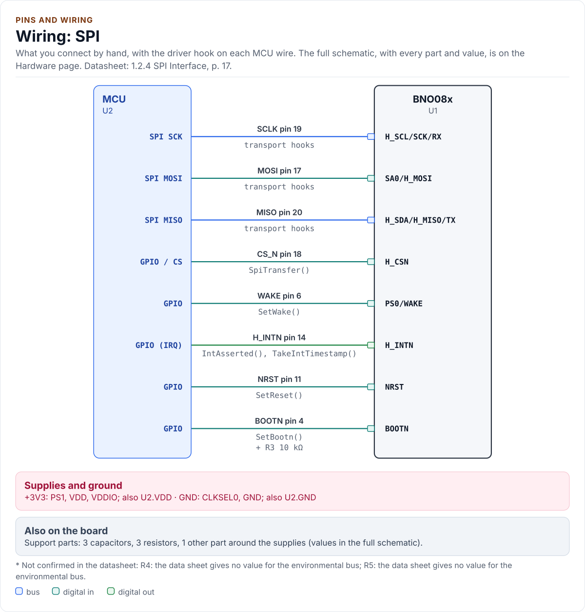
</picture>
<!-- /figure -->

Hardware description: [`docs/hardware.yml`](../hardware.yml)

Drawn from:

- [`docs/hardware.yml`](../hardware.yml)
- [`inc/bno08x_interface.hpp`](../../inc/bno08x_interface.hpp)

## Wiring: UART-RVC

<!-- figure: chip-wiring-uart-rvc -->
<picture>
  <source media="(prefers-color-scheme: dark)" srcset="chip-wiring-uart-rvc.dark.svg">
  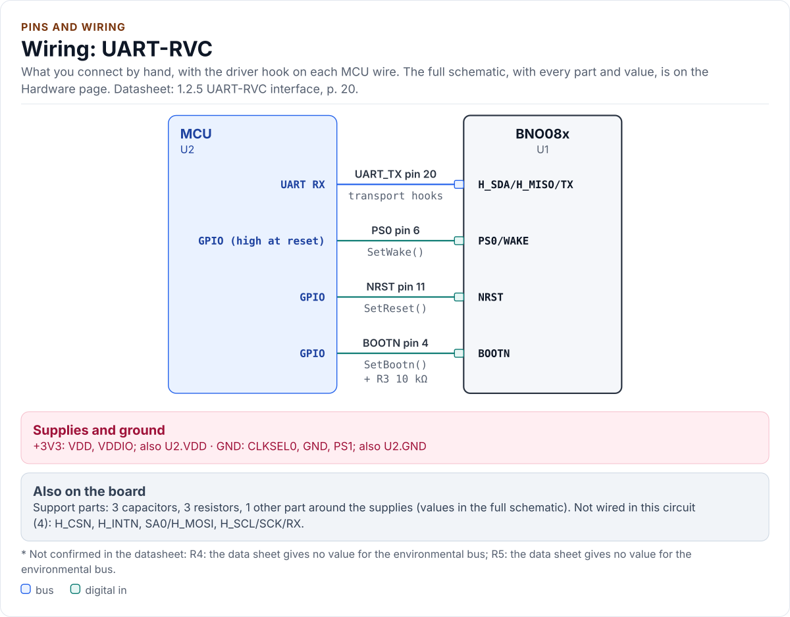
</picture>
<!-- /figure -->

Hardware description: [`docs/hardware.yml`](../hardware.yml)

Drawn from:

- [`docs/hardware.yml`](../hardware.yml)
- [`inc/bno08x_interface.hpp`](../../inc/bno08x_interface.hpp)

## Wiring: UART-SHTP

<!-- figure: chip-wiring-uart-shtp -->
<picture>
  <source media="(prefers-color-scheme: dark)" srcset="chip-wiring-uart-shtp.dark.svg">
  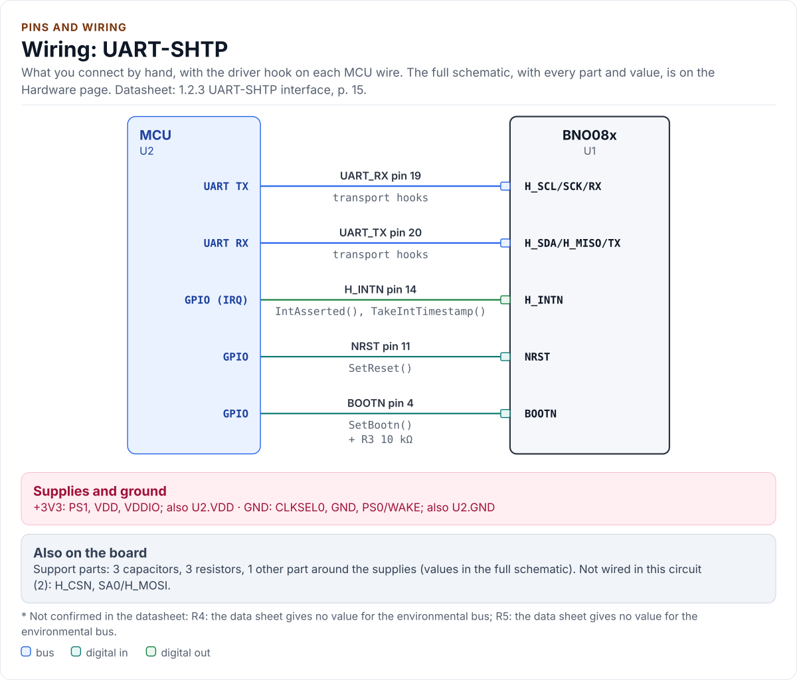
</picture>
<!-- /figure -->

Hardware description: [`docs/hardware.yml`](../hardware.yml)

Drawn from:

- [`docs/hardware.yml`](../hardware.yml)
- [`inc/bno08x_interface.hpp`](../../inc/bno08x_interface.hpp)

## The layers, one of them yours

<!-- figure: driver-layers -->
<picture>
  <source media="(prefers-color-scheme: dark)" srcset="driver-layers.dark.svg">
  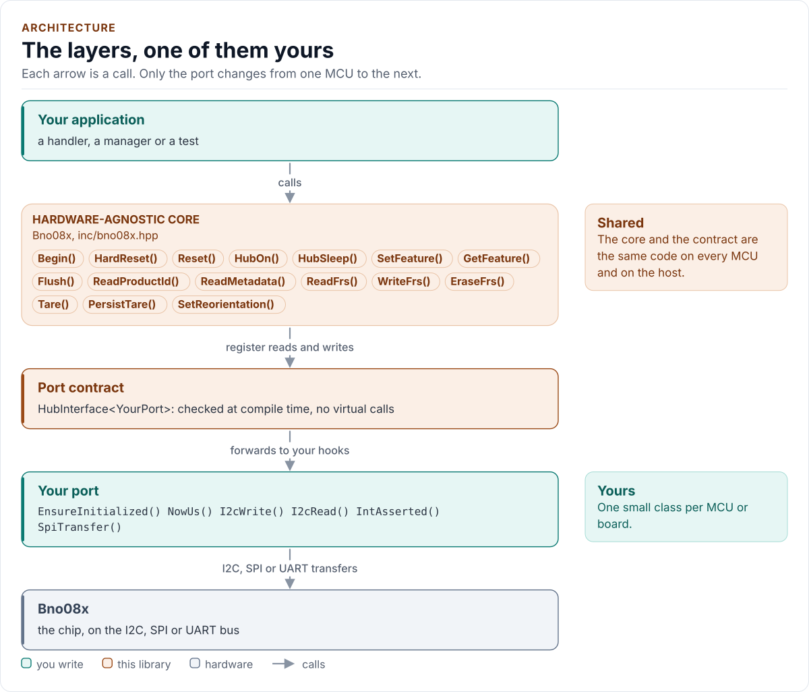
</picture>
<!-- /figure -->

Figure module: [`docs/diagrams/figures/driver-layers.py`](../../docs/diagrams/figures/driver-layers.py)

Drawn from:

- `public calls` in [`inc/bno08x.hpp`](../../inc/bno08x.hpp)
- `HubInterface` in [`inc/bno08x_interface.hpp`](../../inc/bno08x_interface.hpp)

## I2C timing of a read

<!-- figure: i2c-timing -->
<picture>
  <source media="(prefers-color-scheme: dark)" srcset="i2c-timing.dark.svg">
  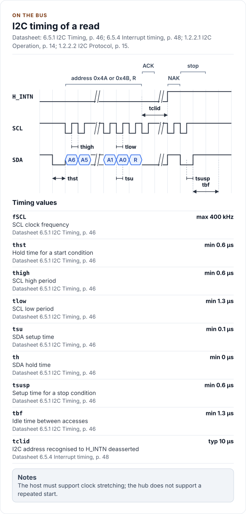
</picture>
<!-- /figure -->

Hardware description: [`docs/model/i2c-timing.timing.yml`](../model/i2c-timing.timing.yml)

Drawn from:

- [`docs/model/i2c-timing.timing.yml`](../model/i2c-timing.timing.yml)

## Two BNO08x on one I2C bus

<!-- figure: i2c-topology -->
<picture>
  <source media="(prefers-color-scheme: dark)" srcset="i2c-topology.dark.svg">
  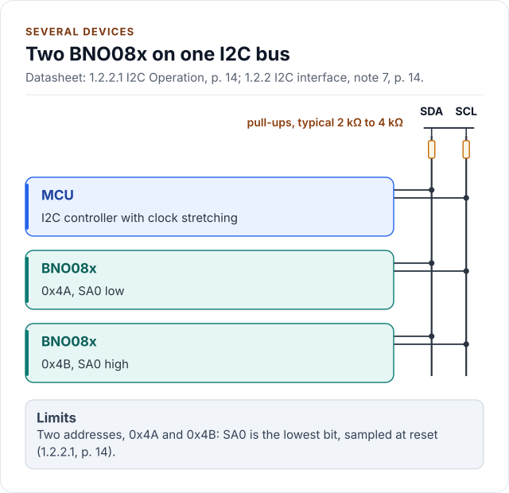
</picture>
<!-- /figure -->

Hardware description: [`docs/model/i2c-topology.topology.yml`](../model/i2c-topology.topology.yml)

Drawn from:

- [`docs/model/i2c-topology.topology.yml`](../model/i2c-topology.topology.yml)

## One sample through the layers

<!-- figure: one-sample-through-the-layers -->
<picture>
  <source media="(prefers-color-scheme: dark)" srcset="one-sample-through-the-layers.dark.svg">
  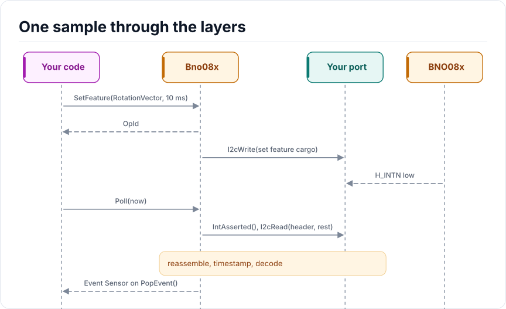
</picture>
<!-- /figure -->

Hardware description: [`docs/model/one-sample-through-the-layers.seq.yml`](../model/one-sample-through-the-layers.seq.yml)

Drawn from:

- [`docs/model/one-sample-through-the-layers.seq.yml`](../model/one-sample-through-the-layers.seq.yml)

## Session states of the driver

<!-- figure: session-states -->
<picture>
  <source media="(prefers-color-scheme: dark)" srcset="session-states.dark.svg">
  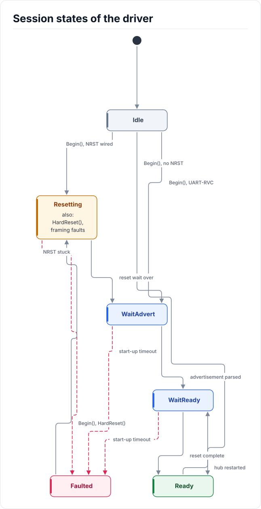
</picture>
<!-- /figure -->

Hardware description: [`docs/model/session-states.state.yml`](../model/session-states.state.yml)

Drawn from:

- [`docs/model/session-states.state.yml`](../model/session-states.state.yml)

## SPI timing with the wake handshake

<!-- figure: spi-timing -->
<picture>
  <source media="(prefers-color-scheme: dark)" srcset="spi-timing.dark.svg">
  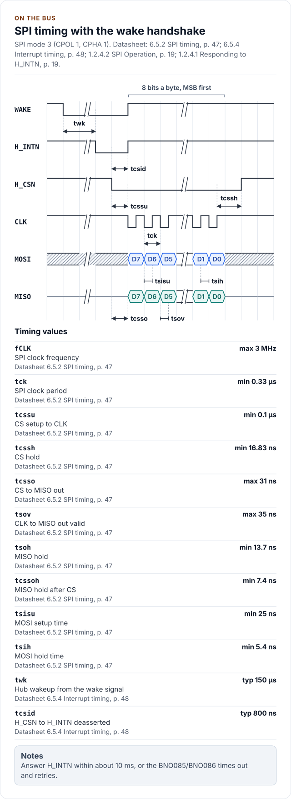
</picture>
<!-- /figure -->

Hardware description: [`docs/model/spi-timing.timing.yml`](../model/spi-timing.timing.yml)

Drawn from:

- [`docs/model/spi-timing.timing.yml`](../model/spi-timing.timing.yml)

## UART-SHTP character

<!-- figure: uart-timing -->
<picture>
  <source media="(prefers-color-scheme: dark)" srcset="uart-timing.dark.svg">
  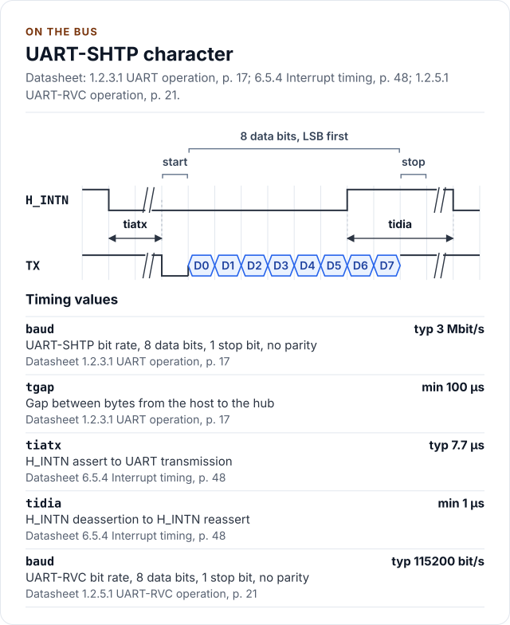
</picture>
<!-- /figure -->

Hardware description: [`docs/model/uart-timing.timing.yml`](../model/uart-timing.timing.yml)

Drawn from:

- [`docs/model/uart-timing.timing.yml`](../model/uart-timing.timing.yml)
