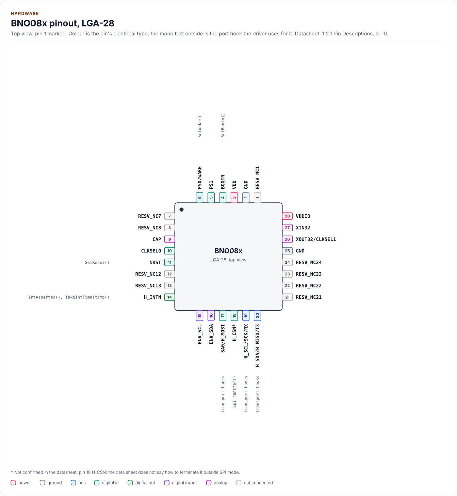
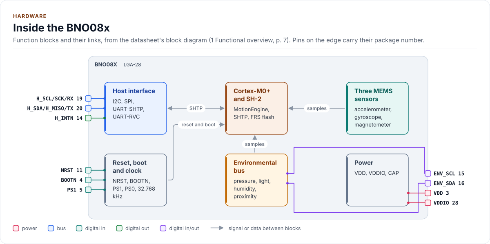
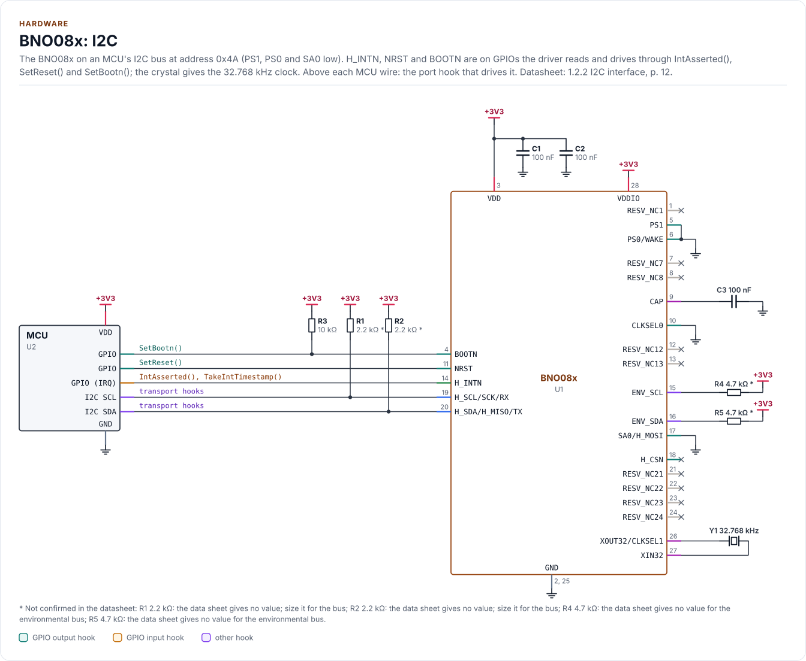
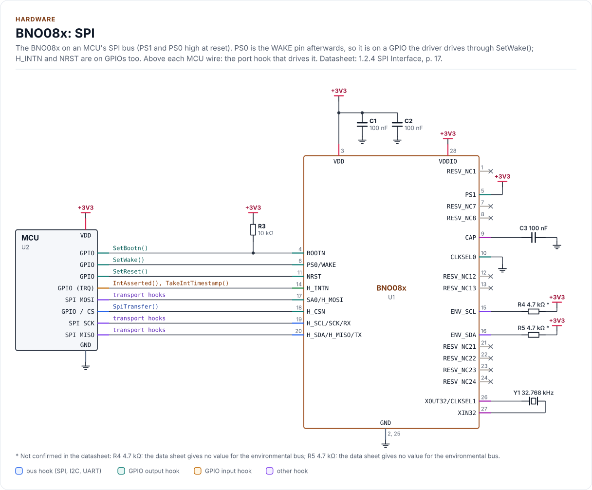
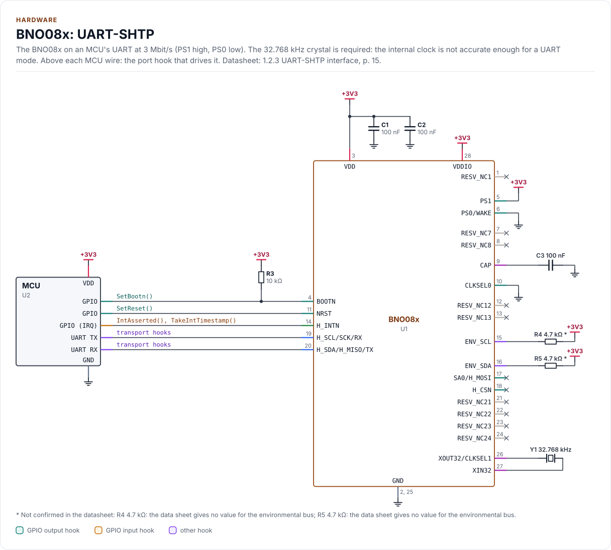
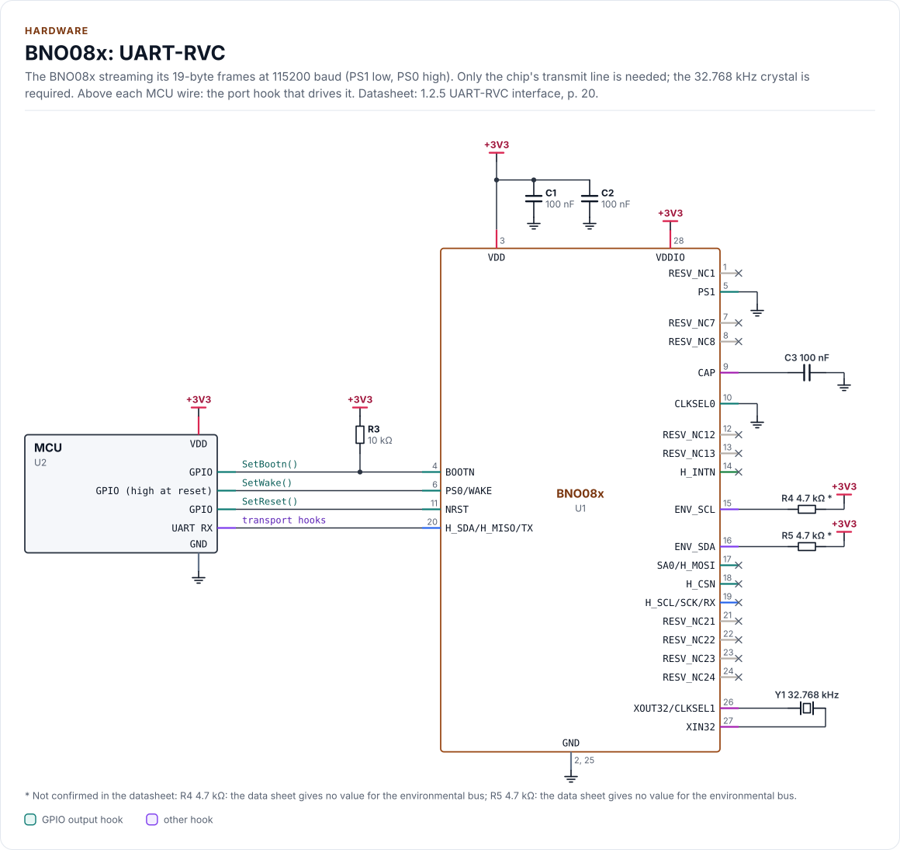

# Hardware

The BNO08x's package, pins, host-interface straps, supplies, timing and reference circuits, as the driver uses them.
The three chips share one package and one pinout; they differ in firmware features only
([Ambiguities](ambiguities.md)).

<!-- generated: datasheet-refs -->
??? abstract "Datasheet sections this page relies on"

    - Features, variants and what differs: CEVA 1000-3927 1.17, Features (front page), [p. 1](https://www.ceva-ip.com/wp-content/uploads/BNO080_085-Datasheet.pdf#page=1)
    - Protocol selection (PS1, PS0): CEVA 1000-3927 1.17, 1.2 BNO08X Connectivity, [p. 9](https://www.ceva-ip.com/wp-content/uploads/BNO080_085-Datasheet.pdf#page=9)
    - Pins, straps and the clock source: CEVA 1000-3927 1.17, 1.2.1 Pin Descriptions, [p. 10](https://www.ceva-ip.com/wp-content/uploads/BNO080_085-Datasheet.pdf#page=10)
    - I2C: address, clock stretching, framing: CEVA 1000-3927 1.17, 1.2.2 I2C interface, [p. 12](https://www.ceva-ip.com/wp-content/uploads/BNO080_085-Datasheet.pdf#page=12)
    - Supplies, absolute maximum ratings and power management: CEVA 1000-3927 1.17, 6.1 Absolute Maximum Electrical Ratings, [p. 45](https://www.ceva-ip.com/wp-content/uploads/BNO080_085-Datasheet.pdf#page=45)
    - Start-up timing: CEVA 1000-3927 1.17, 6.5.3 Startup timing, [p. 47](https://www.ceva-ip.com/wp-content/uploads/BNO080_085-Datasheet.pdf#page=47)
    - Package outline and landing pattern: CEVA 1000-3927 1.17, 7.1 Package Outline, [p. 53](https://www.ceva-ip.com/wp-content/uploads/BNO080_085-Datasheet.pdf#page=53)
    - Pin and interface differences from the BNO070: CEVA (Hillcrest Labs) none printed 1.6, 2.1 Pinout Comparisons, [p. 7](https://www.ceva-ip.com/wp-content/uploads/BNO080-BNO085-Migration-Guide.pdf#page=7)

    All of them, with the driver API for each: [Datasheet map](datasheet.md).
<!-- /generated -->

## Package and pins

A 28-pin LGA, body 5.2 x 3.8 mm, nominal height 1.1 mm, moisture sensitivity level 1, lead-free reflow up to 260 °C
(data sheet section 7). Pin 1 is at the top right of the top view and the numbers run counter-clockwise.

<!-- figure: chip-pinout -->
<picture>
  <source media="(prefers-color-scheme: dark)" srcset="diagrams/chip-pinout.dark.svg">
  
</picture>
<!-- /figure -->

<!-- generated: chip-pins -->
LGA-28, 28 pins (1.2.1 Pin Descriptions, [p. 10](https://www.ceva-ip.com/wp-content/uploads/BNO080_085-Datasheet.pdf#page=10)).

| Pin | Name | Type (domain) | Function | Driver hook | If unused | Datasheet |
| --- | --- | --- | --- | --- | --- | --- |
| 1 | `RESV_NC1` | not connected (VDDIO) | Reserved, no connect | - | - | 1.2.1, [p. 10](https://www.ceva-ip.com/wp-content/uploads/BNO080_085-Datasheet.pdf#page=10) |
| 2 | `GND` | ground | Ground | - | - | 1.2.1, [p. 10](https://www.ceva-ip.com/wp-content/uploads/BNO080_085-Datasheet.pdf#page=10) |
| 3 | `VDD` | power (VDD) | Supply for the sensors, 2.4 V to 3.6 V; on before or with VDDIO | - | - | 1.2.1, [p. 10](https://www.ceva-ip.com/wp-content/uploads/BNO080_085-Datasheet.pdf#page=10) |
| 4 | `BOOTN` | digital in (VDDIO) | Bootloader select, sampled at reset: low starts the bootloader; 10 kΩ pull-up to VDDIO | `SetBootn()` | Pull up to VDDIO through 10 kΩ | 1.2.2, [p. 12](https://www.ceva-ip.com/wp-content/uploads/BNO080_085-Datasheet.pdf#page=12) |
| 5 | `PS1` | digital in (VDDIO) | Protocol select 1, sampled at reset: low I2C or UART-RVC, high UART-SHTP or SPI | - | Tie to the level of the chosen transport | 1.2, [p. 9](https://www.ceva-ip.com/wp-content/uploads/BNO080_085-Datasheet.pdf#page=9) |
| 6 | `PS0/WAKE` | digital in (VDDIO) | Protocol select 0 at reset; in SPI mode afterwards the active-low WAKE input | `SetWake()` | Tie to the level of the chosen transport | 1.2, [p. 9](https://www.ceva-ip.com/wp-content/uploads/BNO080_085-Datasheet.pdf#page=9) |
| 7 | `RESV_NC7` | not connected (VDDIO) | Reserved, no connect | - | - | 1.2.1, [p. 10](https://www.ceva-ip.com/wp-content/uploads/BNO080_085-Datasheet.pdf#page=10) |
| 8 | `RESV_NC8` | not connected (VDDIO) | Reserved, no connect | - | - | 1.2.1, [p. 10](https://www.ceva-ip.com/wp-content/uploads/BNO080_085-Datasheet.pdf#page=10) |
| 9 | `CAP` | analog (VDD) | External capacitor, 100 nF to GND | - | - | 1.2.1, [p. 10](https://www.ceva-ip.com/wp-content/uploads/BNO080_085-Datasheet.pdf#page=10) |
| 10 | `CLKSEL0` | digital in (VDDIO) | Clock source select 0, internal pull-down: low or open for a crystal, high for an external or internal clock | - | Leave open for the crystal | 1.2.1, [p. 11](https://www.ceva-ip.com/wp-content/uploads/BNO080_085-Datasheet.pdf#page=11) |
| 11 | `NRST` | digital in (VDDIO) | Active-low reset | `SetReset()` | Tie high; reset by power cycling | 6.5.3, [p. 47](https://www.ceva-ip.com/wp-content/uploads/BNO080_085-Datasheet.pdf#page=47) |
| 12 | `RESV_NC12` | not connected (VDDIO) | Reserved, no connect | - | - | 1.2.1, [p. 10](https://www.ceva-ip.com/wp-content/uploads/BNO080_085-Datasheet.pdf#page=10) |
| 13 | `RESV_NC13` | not connected (VDDIO) | Reserved, no connect | - | - | 1.2.1, [p. 10](https://www.ceva-ip.com/wp-content/uploads/BNO080_085-Datasheet.pdf#page=10) |
| 14 | `H_INTN` | digital out (VDDIO) | Interrupt to the host, active low: a cargo is waiting (I2C, SPI) or about to arrive (UART) | `IntAsserted(), TakeIntTimestamp()` | The driver cannot run the I2C or SPI transport without it | 1.2.1, [p. 10](https://www.ceva-ip.com/wp-content/uploads/BNO080_085-Datasheet.pdf#page=10) |
| 15 | `ENV_SCL` | digital in/out (VDDIO) | Clock of the environmental sensors' I2C bus; pull up even when no sensor is fitted | - | Pull up to VDDIO | 2.3, [p. 33](https://www.ceva-ip.com/wp-content/uploads/BNO080_085-Datasheet.pdf#page=33) |
| 16 | `ENV_SDA` | digital in/out (VDDIO) | Data of the environmental sensors' I2C bus; pull up even when no sensor is fitted | - | Pull up to VDDIO | 2.3, [p. 33](https://www.ceva-ip.com/wp-content/uploads/BNO080_085-Datasheet.pdf#page=33) |
| 17 | `SA0/H_MOSI` | digital in (VDDIO) | I2C address bit 0 sampled at reset (low 0x4A, high 0x4B); in SPI mode the data input | `transport hooks` | - | 1.2.2, [p. 12](https://www.ceva-ip.com/wp-content/uploads/BNO080_085-Datasheet.pdf#page=12) |
| 18 | `H_CSN` [^1] | digital in (VDDIO) | SPI chip select, active low | `SpiTransfer()` | Tie high outside SPI mode | 1.2.4, [p. 17](https://www.ceva-ip.com/wp-content/uploads/BNO080_085-Datasheet.pdf#page=17) |
| 19 | `H_SCL/SCK/RX` | bus (VDDIO) | I2C clock, SPI clock or UART receive | `transport hooks` | - | 1.2.1, [p. 10](https://www.ceva-ip.com/wp-content/uploads/BNO080_085-Datasheet.pdf#page=10) |
| 20 | `H_SDA/H_MISO/TX` | bus (VDDIO) | I2C data, SPI data out or UART transmit | `transport hooks` | - | 1.2.1, [p. 10](https://www.ceva-ip.com/wp-content/uploads/BNO080_085-Datasheet.pdf#page=10) |
| 21 | `RESV_NC21` | not connected (VDDIO) | Reserved, no connect | - | - | 1.2.1, [p. 10](https://www.ceva-ip.com/wp-content/uploads/BNO080_085-Datasheet.pdf#page=10) |
| 22 | `RESV_NC22` | not connected (VDDIO) | Reserved, no connect | - | - | 1.2.1, [p. 10](https://www.ceva-ip.com/wp-content/uploads/BNO080_085-Datasheet.pdf#page=10) |
| 23 | `RESV_NC23` | not connected (VDDIO) | Reserved, no connect | - | - | 1.2.1, [p. 10](https://www.ceva-ip.com/wp-content/uploads/BNO080_085-Datasheet.pdf#page=10) |
| 24 | `RESV_NC24` | not connected (VDDIO) | Reserved, no connect | - | - | 1.2.1, [p. 10](https://www.ceva-ip.com/wp-content/uploads/BNO080_085-Datasheet.pdf#page=10) |
| 25 | `GND` | ground | Ground | - | - | 1.2.1, [p. 10](https://www.ceva-ip.com/wp-content/uploads/BNO080_085-Datasheet.pdf#page=10) |
| 26 | `XOUT32/CLKSEL1` | analog (VDDIO) | 32.768 kHz crystal output, or clock source select 1 (internal pull-down) | - | Leave open with the internal clock | 1.2.1, [p. 11](https://www.ceva-ip.com/wp-content/uploads/BNO080_085-Datasheet.pdf#page=11) |
| 27 | `XIN32` | analog (VDDIO) | 32.768 kHz crystal input, or the external clock | - | Leave open with the internal clock | 1.2.1, [p. 11](https://www.ceva-ip.com/wp-content/uploads/BNO080_085-Datasheet.pdf#page=11) |
| 28 | `VDDIO` | power (VDDIO) | Supply for the core and the I/O, 1.7 V to 3.6 V (the pin table says 1.65 V) | - | - | 1.2.1, [p. 10](https://www.ceva-ip.com/wp-content/uploads/BNO080_085-Datasheet.pdf#page=10) |

[^1]: Not confirmed in the datasheet: pin 18 (H_CSN): the data sheet does not say how to terminate it outside SPI mode.

Source of this table and of the chip figures: [`docs/hardware.yml`](hardware.yml).
<!-- /generated -->

Source of this table and of the chip figures: [`docs/hardware.yml`](hardware.yml).

## Choosing the host interface

Two strap pins, PS1 and PS0, and BOOTN are sampled at reset and choose the host interface. The driver does not
detect it: the port you write names the transport (`kTransport`) and the wiring must agree.

| PS1 | PS0 | Host interface | Driver transport |
| --- | --- | --- | --- |
| 0 | 0 | I2C | `Transport::I2c` |
| 0 | 1 | UART-RVC | `Transport::UartRvc` |
| 1 | 0 | UART with SHTP | `Transport::UartShtp` |
| 1 | 1 | SPI | `Transport::Spi` |

BOOTN must be high at reset for the application to start; it needs a 10 kΩ pull-up (a low level starts the
bootloader, which this driver does not support). SPI needs both strap pins high from before reset until after the
first H_INTN, and PS0 must be a GPIO because it becomes the WAKE input afterwards.

The clock source is chosen by CLKSEL0 and CLKSEL1 at reset: a 32.768 kHz crystal (CLKSEL0 low or open), an external
clock on pin 27 (both high), or the internal oscillator (CLKSEL0 high, CLKSEL1 low or open). **The internal
oscillator must not be used with either UART mode**; I2C and SPI tolerate it. The environmental sensor bus pins
ENV_SCL and ENV_SDA need pull-ups even when no sensor is fitted.

## Pin hooks

| Pin | Port hook | What the driver does with it |
| --- | --- | --- |
| NRST | `SetReset(bool)` | Pulses it low at `Begin()` and `HardReset()`; without it the driver asks the running hub for its advertisement |
| H_INTN | `IntAsserted()` | Reads only when it is low (I2C, SPI); on UART it is optional |
| H_INTN edge | `TakeIntTimestamp(uint32_t&)` | Optional: the time of the edge, for exact sample timestamps |
| PS0/WAKE | `SetWake(bool)` | SPI: pulls it low before a write |
| BOOTN | `SetBootn(bool)` | Optional: held high during the reset sequence |

## Timing

| Parameter | Value | Driver |
| --- | --- | --- |
| NRST pulse | at least 10 ns | `Config::reset_pulse_us` (default 1 ms) |
| Internal initialisation after reset | t1 at least 90 ms, then t2 about 4 ms | `Config::startup_timeout_ms` bounds each wait |
| H_INTN after WAKE (SPI) | 150 µs typical | `Config::wake_timeout_us` |
| Host answer to H_INTN | within about 10 ms, or the hub gives up and raises it again | `Poll()` should run every few milliseconds ([Transports](transports.md)) |
| UART-SHTP host bytes | at least 100 µs apart | The driver paces them; or your port does |
| SPI clock | mode 3, up to 3 MHz | Your port |
| I2C clock | 100 or 400 kHz; the hub stretches the clock | Your port |

## Supplies

VDD 2.4 V to 3.6 V powers the sensors; VDDIO 1.7 V to 3.6 V powers the core and the I/O (the pin table says
1.65 V; the operating-conditions table, which the driver's documentation follows, says 1.7 V). VDD must be on before
or together with VDDIO. Put 100 nF at each supply pin and 100 nF from CAP to GND.

## Block diagram

<!-- figure: chip-blocks -->
<picture>
  <source media="(prefers-color-scheme: dark)" srcset="diagrams/chip-blocks.dark.svg">
  
</picture>
<!-- /figure -->

## Reference circuits

The same chip on each host interface. The strap pins are tied exactly as the table above says.

### I2C

<!-- figure: chip-circuit-i2c -->
<picture>
  <source media="(prefers-color-scheme: dark)" srcset="diagrams/chip-circuit-i2c.dark.svg">
  
</picture>
<!-- /figure -->

### SPI

<!-- figure: chip-circuit-spi -->
<picture>
  <source media="(prefers-color-scheme: dark)" srcset="diagrams/chip-circuit-spi.dark.svg">
  
</picture>
<!-- /figure -->

### UART-SHTP

<!-- figure: chip-circuit-uart-shtp -->
<picture>
  <source media="(prefers-color-scheme: dark)" srcset="diagrams/chip-circuit-uart-shtp.dark.svg">
  
</picture>
<!-- /figure -->

### UART-RVC

<!-- figure: chip-circuit-uart-rvc -->
<picture>
  <source media="(prefers-color-scheme: dark)" srcset="diagrams/chip-circuit-uart-rvc.dark.svg">
  
</picture>
<!-- /figure -->

<!-- generated: chip-parts -->
**I2C** (figure `chip-circuit-i2c`)

| Part | Kind | Value | Connects | Datasheet |
| --- | --- | --- | --- | --- |
| U2 | MCU | - | VDD: +3V3, GND: GND, SCL: SCL, SDA: SDA, INT: H_INTN, RST: NRST, BOOT: BOOTN | 1.2.2, [p. 12](https://www.ceva-ip.com/wp-content/uploads/BNO080_085-Datasheet.pdf#page=12) |
| C1 | capacitor | 100 nF | +3V3, GND | 6.2, [p. 45](https://www.ceva-ip.com/wp-content/uploads/BNO080_085-Datasheet.pdf#page=45) |
| C2 | capacitor | 100 nF | +3V3, GND | 6.2, [p. 45](https://www.ceva-ip.com/wp-content/uploads/BNO080_085-Datasheet.pdf#page=45) |
| C3 | capacitor | 100 nF | GND, CAP | 1.2.1, [p. 10](https://www.ceva-ip.com/wp-content/uploads/BNO080_085-Datasheet.pdf#page=10) |
| R1 | resistor | 2.2 kΩ (not confirmed: the data sheet gives no value; size it for the bus) | +3V3, SCL | 1.2.2, [p. 12](https://www.ceva-ip.com/wp-content/uploads/BNO080_085-Datasheet.pdf#page=12) |
| R2 | resistor | 2.2 kΩ (not confirmed: the data sheet gives no value; size it for the bus) | +3V3, SDA | 1.2.2, [p. 12](https://www.ceva-ip.com/wp-content/uploads/BNO080_085-Datasheet.pdf#page=12) |
| R3 | resistor | 10 kΩ | +3V3, BOOTN | 1.2.2, [p. 12](https://www.ceva-ip.com/wp-content/uploads/BNO080_085-Datasheet.pdf#page=12) |
| R4 | resistor | 4.7 kΩ (not confirmed: the data sheet gives no value for the environmental bus) | +3V3, ENV_SCL | 2.3, [p. 33](https://www.ceva-ip.com/wp-content/uploads/BNO080_085-Datasheet.pdf#page=33) |
| R5 | resistor | 4.7 kΩ (not confirmed: the data sheet gives no value for the environmental bus) | +3V3, ENV_SDA | 2.3, [p. 33](https://www.ceva-ip.com/wp-content/uploads/BNO080_085-Datasheet.pdf#page=33) |
| Y1 | crystal | 32.768 kHz | XOUT32, XIN32 | 1.2.1, [p. 11](https://www.ceva-ip.com/wp-content/uploads/BNO080_085-Datasheet.pdf#page=11) |

**SPI** (figure `chip-circuit-spi`)

| Part | Kind | Value | Connects | Datasheet |
| --- | --- | --- | --- | --- |
| U2 | MCU | - | VDD: +3V3, GND: GND, SCK: SCLK, MOSI: MOSI, MISO: MISO, CS: CS_N, WAKE: WAKE, INT: H_INTN, RST: NRST, BOOT: BOOTN | 1.2.4, [p. 17](https://www.ceva-ip.com/wp-content/uploads/BNO080_085-Datasheet.pdf#page=17) |
| C1 | capacitor | 100 nF | +3V3, GND | 6.2, [p. 45](https://www.ceva-ip.com/wp-content/uploads/BNO080_085-Datasheet.pdf#page=45) |
| C2 | capacitor | 100 nF | +3V3, GND | 6.2, [p. 45](https://www.ceva-ip.com/wp-content/uploads/BNO080_085-Datasheet.pdf#page=45) |
| C3 | capacitor | 100 nF | GND, CAP | 1.2.1, [p. 10](https://www.ceva-ip.com/wp-content/uploads/BNO080_085-Datasheet.pdf#page=10) |
| R3 | resistor | 10 kΩ | +3V3, BOOTN | 1.2.2, [p. 12](https://www.ceva-ip.com/wp-content/uploads/BNO080_085-Datasheet.pdf#page=12) |
| R4 | resistor | 4.7 kΩ (not confirmed: the data sheet gives no value for the environmental bus) | +3V3, ENV_SCL | 2.3, [p. 33](https://www.ceva-ip.com/wp-content/uploads/BNO080_085-Datasheet.pdf#page=33) |
| R5 | resistor | 4.7 kΩ (not confirmed: the data sheet gives no value for the environmental bus) | +3V3, ENV_SDA | 2.3, [p. 33](https://www.ceva-ip.com/wp-content/uploads/BNO080_085-Datasheet.pdf#page=33) |
| Y1 | crystal | 32.768 kHz | XOUT32, XIN32 | 1.2.1, [p. 11](https://www.ceva-ip.com/wp-content/uploads/BNO080_085-Datasheet.pdf#page=11) |

**UART-SHTP** (figure `chip-circuit-uart-shtp`)

| Part | Kind | Value | Connects | Datasheet |
| --- | --- | --- | --- | --- |
| U2 | MCU | - | VDD: +3V3, GND: GND, TX: UART_RX, RX: UART_TX, INT: H_INTN, RST: NRST, BOOT: BOOTN | 1.2.3, [p. 15](https://www.ceva-ip.com/wp-content/uploads/BNO080_085-Datasheet.pdf#page=15) |
| C1 | capacitor | 100 nF | +3V3, GND | 6.2, [p. 45](https://www.ceva-ip.com/wp-content/uploads/BNO080_085-Datasheet.pdf#page=45) |
| C2 | capacitor | 100 nF | +3V3, GND | 6.2, [p. 45](https://www.ceva-ip.com/wp-content/uploads/BNO080_085-Datasheet.pdf#page=45) |
| C3 | capacitor | 100 nF | GND, CAP | 1.2.1, [p. 10](https://www.ceva-ip.com/wp-content/uploads/BNO080_085-Datasheet.pdf#page=10) |
| R3 | resistor | 10 kΩ | +3V3, BOOTN | 1.2.2, [p. 12](https://www.ceva-ip.com/wp-content/uploads/BNO080_085-Datasheet.pdf#page=12) |
| R4 | resistor | 4.7 kΩ (not confirmed: the data sheet gives no value for the environmental bus) | +3V3, ENV_SCL | 2.3, [p. 33](https://www.ceva-ip.com/wp-content/uploads/BNO080_085-Datasheet.pdf#page=33) |
| R5 | resistor | 4.7 kΩ (not confirmed: the data sheet gives no value for the environmental bus) | +3V3, ENV_SDA | 2.3, [p. 33](https://www.ceva-ip.com/wp-content/uploads/BNO080_085-Datasheet.pdf#page=33) |
| Y1 | crystal | 32.768 kHz | XOUT32, XIN32 | 1.2.1, [p. 11](https://www.ceva-ip.com/wp-content/uploads/BNO080_085-Datasheet.pdf#page=11) |

**UART-RVC** (figure `chip-circuit-uart-rvc`)

| Part | Kind | Value | Connects | Datasheet |
| --- | --- | --- | --- | --- |
| U2 | MCU | - | VDD: +3V3, GND: GND, RX: UART_TX, MODE: PS0, RST: NRST, BOOT: BOOTN | 1.2.5, [p. 20](https://www.ceva-ip.com/wp-content/uploads/BNO080_085-Datasheet.pdf#page=20) |
| C1 | capacitor | 100 nF | +3V3, GND | 6.2, [p. 45](https://www.ceva-ip.com/wp-content/uploads/BNO080_085-Datasheet.pdf#page=45) |
| C2 | capacitor | 100 nF | +3V3, GND | 6.2, [p. 45](https://www.ceva-ip.com/wp-content/uploads/BNO080_085-Datasheet.pdf#page=45) |
| C3 | capacitor | 100 nF | GND, CAP | 1.2.1, [p. 10](https://www.ceva-ip.com/wp-content/uploads/BNO080_085-Datasheet.pdf#page=10) |
| R3 | resistor | 10 kΩ | +3V3, BOOTN | 1.2.2, [p. 12](https://www.ceva-ip.com/wp-content/uploads/BNO080_085-Datasheet.pdf#page=12) |
| R4 | resistor | 4.7 kΩ (not confirmed: the data sheet gives no value for the environmental bus) | +3V3, ENV_SCL | 2.3, [p. 33](https://www.ceva-ip.com/wp-content/uploads/BNO080_085-Datasheet.pdf#page=33) |
| R5 | resistor | 4.7 kΩ (not confirmed: the data sheet gives no value for the environmental bus) | +3V3, ENV_SDA | 2.3, [p. 33](https://www.ceva-ip.com/wp-content/uploads/BNO080_085-Datasheet.pdf#page=33) |
| Y1 | crystal | 32.768 kHz | XOUT32, XIN32 | 1.2.1, [p. 11](https://www.ceva-ip.com/wp-content/uploads/BNO080_085-Datasheet.pdf#page=11) |

Export a circuit for a schematic or PCB tool: `kokeb-docs hardware --kicad-netlist OUT.net --circuit i2c`.
<!-- /generated -->

## Reference documents

The data sheet, the SH-2 reference manual and the SHTP documents are listed with their revision, their SHA-256 and
where to get them in [`docs/datasheets.yml`](datasheets.yml); every pin, setting and timing on this page cites a
section of them.

<!-- generated: datasheet-card -->
| Document | Revision | Get it |
| --- | --- | --- |
| Datasheet: BNO080/BNO085/BNO086 data sheet (CEVA 1000-3927) | 1.17, 2023-07-24 | [PDF](https://www.ceva-ip.com/wp-content/uploads/BNO080_085-Datasheet.pdf) · [vendor page](https://www.ceva-ip.com/wp-content/uploads/BNO080_085-Datasheet.pdf) |
| Datasheet: BNO080/BNO085 data sheet (earlier revision, history only) (CEVA 1000-3927) | 1.8, 2020-02-05 | [PDF](https://xdevs.com/doc/CEVA/BNO080_085-Datasheet.pdf) · [vendor page](https://xdevs.com/doc/CEVA/BNO080_085-Datasheet.pdf) |
| Datasheet: BNO080 data sheet (earliest revision) (CEVA (Hillcrest Labs) 1000-3927) | 1.3, 2017-10-01 | [PDF](https://cdn.sparkfun.com/assets/b/e/e/7/4/BNO080.pdf) · [vendor page](https://cdn.sparkfun.com/assets/b/e/e/7/4/BNO080.pdf) |
| Datasheet companion, reference manual: SH-2 Reference Manual (CEVA 1000-3625) | 1.9, 2021-06-10 | [PDF](https://www.ceva-ip.com/wp-content/uploads/SH-2-Reference-Manual.pdf) · [vendor page](https://www.ceva-ip.com/wp-content/uploads/SH-2-Reference-Manual.pdf) |
| Datasheet companion, reference manual: SH-2 Reference Manual (earlier revision, history only) (CEVA (Hillcrest Labs) 1000-3625) | 1.2, 2017-05-19 | [PDF](https://cdn.sparkfun.com/assets/4/d/9/3/8/SH-2-Reference-Manual-v1.2.pdf) · [vendor page](https://cdn.sparkfun.com/assets/4/d/9/3/8/SH-2-Reference-Manual-v1.2.pdf) |
| Datasheet companion, protocol: Sensor Hub Transport Protocol (SHTP) (CEVA 1000-3535) | 1.10, 2021-06-10 | [PDF](https://www.ceva-ip.com/wp-content/uploads/Sensor-Hub-Transport-Protocol.pdf) · [vendor page](https://www.ceva-ip.com/wp-content/uploads/Sensor-Hub-Transport-Protocol.pdf) |
| Datasheet companion, protocol: SH-2 SHTP Reference Manual (CEVA 1000-3600) | 1.6, 2019-01-01 | [PDF](https://www.ceva-ip.com/wp-content/uploads/SH-2-SHTP-Reference-Manual.pdf) · [vendor page](https://www.ceva-ip.com/wp-content/uploads/SH-2-SHTP-Reference-Manual.pdf) |
| Datasheet companion, application note: BNO080/BNO085 calibration guide (CEVA 1000-4044) | 1.6, 2023-02-01 | [PDF](https://www.ceva-ip.com/wp-content/uploads/BNO080-BNO085-Sesnor-Calibration-Procedure.pdf) · [vendor page](https://www.ceva-ip.com/wp-content/uploads/BNO080-BNO085-Sesnor-Calibration-Procedure.pdf) |
| Datasheet companion, application note: BNO080/BNO085 calibration procedure (earlier revision) (CEVA 1000-4044) | 1.3, 2019-07-01 | [PDF](https://xdevs.com/doc/CEVA/BNO080-BNO085-Sesnor-Calibration-Procedure.pdf) · [vendor page](https://xdevs.com/doc/CEVA/BNO080-BNO085-Sesnor-Calibration-Procedure.pdf) |
| Datasheet companion, application note: BNO085/BNO086 tare usage guide (CEVA 1000-4045) | 1.3, 2023-02-01 | [PDF](https://www.ceva-ip.com/wp-content/uploads/BNO080-BNO085-Tare-Function-Usage-Guide.pdf) · [vendor page](https://www.ceva-ip.com/wp-content/uploads/BNO080-BNO085-Tare-Function-Usage-Guide.pdf) |
| Datasheet companion, application note: BNO080/BNO085 migration guide (from the BNO070) (CEVA (Hillcrest Labs) none printed) | 1.6, 2017-10-01 | [PDF](https://www.ceva-ip.com/wp-content/uploads/BNO080-BNO085-Migration-Guide.pdf) · [vendor page](https://www.ceva-ip.com/wp-content/uploads/BNO080-BNO085-Migration-Guide.pdf) |
| Datasheet: FSP200 data sheet (same SH-2, read for context only) (CEVA 1000-4121) | 1.5, 2022-09-01 | [PDF](https://datasheet.sic-components.com/FSP200-Datasheet.pdf) · [vendor page](https://datasheet.sic-components.com/FSP200-Datasheet.pdf) |
| Datasheet: BMF055 data sheet (same silicon; electrical limits cross-check only) (Bosch Sensortec BST-BMF055-DS000) | 0.4, 2020-11-01 | [vendor page](https://www.bosch-sensortec.com/media/boschsensortec/downloads/datasheets/bst-bmf055-ds000.pdf) |
| Datasheet companion, application note: BNO055 handling, soldering and mounting instructions (mounting cross-check only) (Bosch Sensortec BST-BNO055-HS000) | 1.0, 2015-01-01 | [vendor page](https://www.bosch-sensortec.com/media/boschsensortec/downloads/handling_soldering_mounting_instructions/bst-bno055-hs000.pdf) |

Written against these revisions; the SHA-256 of each file is in [`docs/datasheets.yml`](datasheets.yml). Where each part
of the driver is in the datasheet: [Datasheet map](datasheet.md).
<!-- /generated -->

| Also useful | Contents |
| --- | --- |
| [`inc/bno08x_registers.hpp`](../inc/bno08x_registers.hpp) | Report IDs, command numbers, record IDs and lengths, with the manual's section numbers |
| [`docs/hardware.yml`](hardware.yml) | The pins, hooks, blocks and circuits as data |
