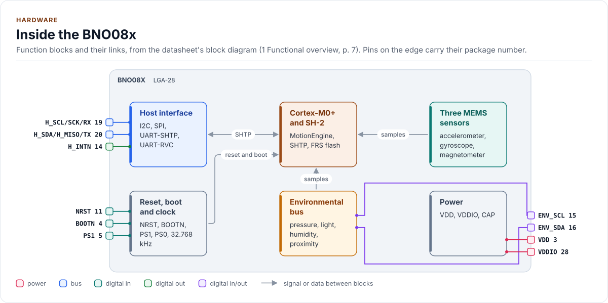
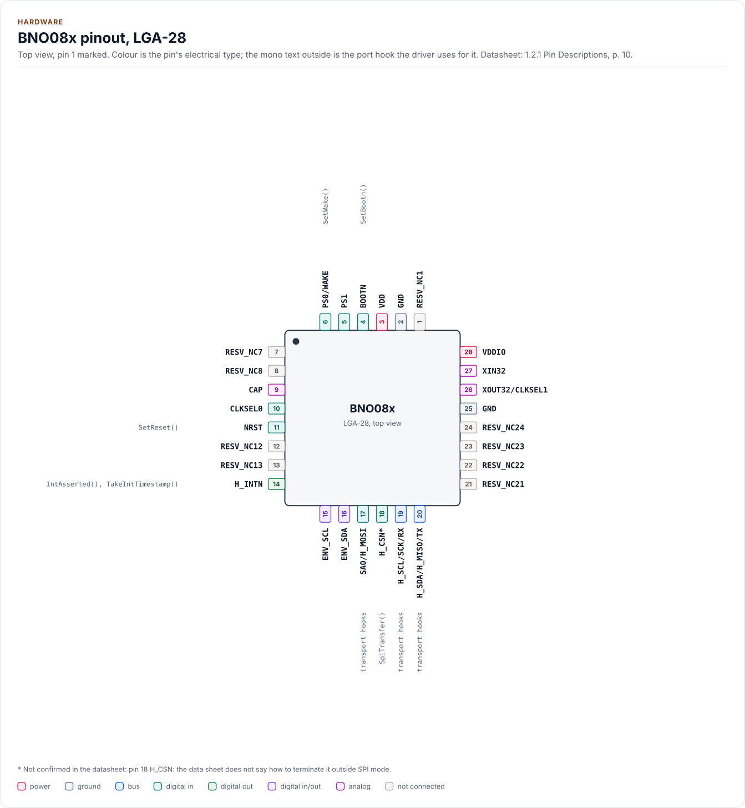
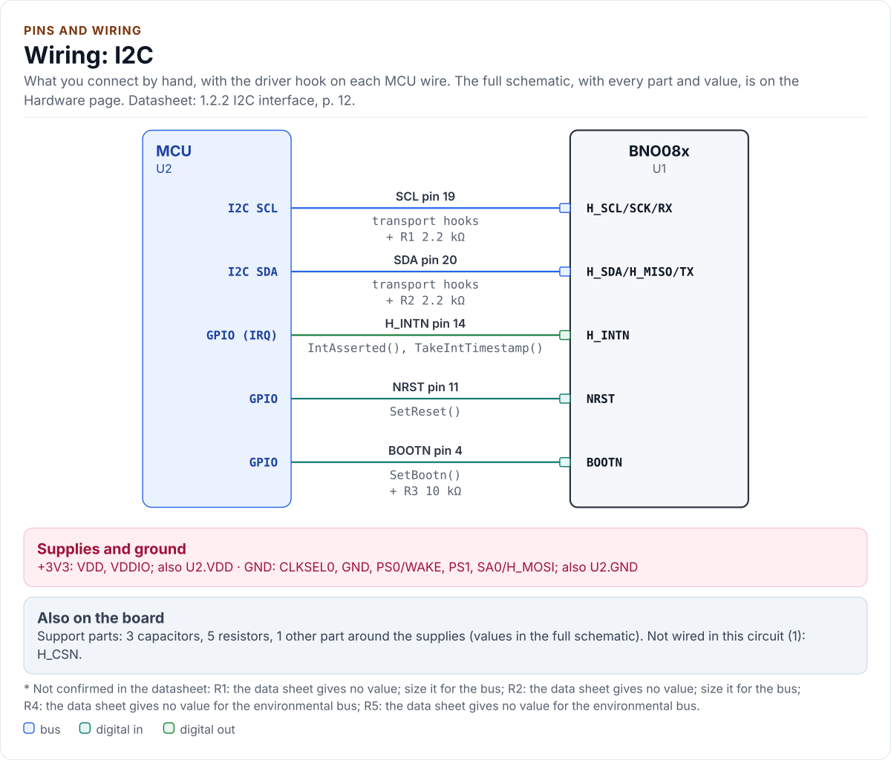

---
hide:
  - navigation
  - toc
---

<div class="kb-hero" markdown>
<span class="kb-kicker">Driver</span>

# BNO08x Driver

<p>A C++20 driver for the CEVA BNO080, BNO085 and BNO086 smart sensor hubs. It speaks SHTP and SH-2 over I2C, SPI
and UART, and the stand-alone UART-RVC mode, on any MCU, with no heap and no blocking call.</p>

[Quickstart](quickstart.md){ .md-button .md-button--primary }
[API guide](api-guide.md){ .md-button }
[Source on GitHub](https://github.com/kokeb-labs-drivers/driver-bno08x){ .md-button }
</div>

<!-- generated: chip-summary -->
The **BNO08x** is a 9-axis sensor hub in one package: an accelerometer, a gyroscope and a magnetometer with a Cortex-M0+
that runs the sensor fusion and reports finished orientation, motion and activity results to the host (Title page, [p.
1](https://www.ceva-ip.com/wp-content/uploads/BNO080_085-Datasheet.pdf#page=1)).
<!-- /generated -->

<!-- figure: chip-hero -->
<picture>
  <source media="(prefers-color-scheme: dark)" srcset="diagrams/chip-hero.dark.svg">
  
</picture>
<!-- /figure -->

## What it does

<!-- figure: chip-capabilities -->
<picture>
  <source media="(prefers-color-scheme: dark)" srcset="diagrams/chip-capabilities.dark.svg">
  
</picture>
<!-- /figure -->

## Where it is used

<!-- generated: chip-uses -->
- Sensor hub of a mobile device: always-on activity, gestures and dead reckoning (1.1.1, [p. 8](https://www.ceva-ip.com/wp-content/uploads/BNO080_085-Datasheet.pdf#page=8))
- Head tracker of a VR or AR headset (1.1.2, [p. 8](https://www.ceva-ip.com/wp-content/uploads/BNO080_085-Datasheet.pdf#page=8))
- Unmanned ground robot (1.1.3, [p. 9](https://www.ceva-ip.com/wp-content/uploads/BNO080_085-Datasheet.pdf#page=9))

Uses named by the datasheet (Title page, [p.
1](https://www.ceva-ip.com/wp-content/uploads/BNO080_085-Datasheet.pdf#page=1)).
<!-- /generated -->

## Inside the chip

<!-- figure: chip-blocks -->
<picture>
  <source media="(prefers-color-scheme: dark)" srcset="diagrams/chip-blocks.dark.svg">
  
</picture>
<!-- /figure -->

## Pins and wiring

<!-- figure: chip-pinout -->
<picture>
  <source media="(prefers-color-scheme: dark)" srcset="diagrams/chip-pinout.dark.svg">
  
</picture>
<!-- /figure -->

<!-- figure: chip-wiring-i2c -->
<picture>
  <source media="(prefers-color-scheme: dark)" srcset="diagrams/chip-wiring-i2c.dark.svg">
  
</picture>
<!-- /figure -->

<div class="kb-chip" markdown>
<div class="kb-chip__head">
<span class="kb-chip__kicker">Smart sensor hub</span>
<span class="kb-chip__name">BNO080, BNO085, BNO086</span>
<span class="kb-chip__vendor">CEVA</span>
</div>

Function
:   Accelerometer, gyroscope and magnetometer fused by the MotionEngine into rotation vectors, motion and activity
    reports

Interface
:   I2C (0x4A or 0x4B), SPI mode 3 up to 3 MHz, UART-SHTP at 3 Mbit/s, or UART-RVC at 115200 baud; chosen by two
    strap pins at reset

Reports
:   Every sensor report of the SH-2 reference manual, batched and timestamped, from 1 Hz to 1 kHz

Configuration
:   Calibration, tare, orientation and the flash record store (FRS), read and written by record

Supply
:   VDD 2.4 V to 3.6 V, VDDIO 1.7 V to 3.6 V
</div>

Every pin, the reference circuits, the bus settings, the timing and the power: [Hardware](hardware.md).

## Quick start

Wire the chip as above, write the port for your MCU ([Porting](porting.md)), then:

<!-- generated: quickstart-code -->
```cpp
void RunSensor() {
  static MyPort port;
  static bno08x::Bno08x<MyPort> hub(port); // no I/O yet

  const bno08x::Config cfg{}; // BNO085 on I2C 0x4A
  if (const auto r = hub.Begin(cfg); !r.ok()) {
    std::printf("Begin: %s\n", bno08x::ToString(r.error));
    return;
  }

  bool requested = false;
  for (;;) {
    hub.Poll(port.NowUs()); // every few milliseconds: reads, writes and time-outs all happen here
    if (hub.Ready() && !requested) {
      bno08x::FeatureConfig fc{};
      fc.interval_us = 20000; // 50 Hz
      requested = hub.SetFeature(bno08x::SensorId::RotationVector, fc).ok();
    }
    bno08x::Event e{};
    while (hub.PopEvent(e)) {
      if (e.kind == bno08x::EventKind::Sensor) {
        const auto eu = bno08x::ToEulerCentiDeg(e.v[0], e.v[1], e.v[2], e.v[3]);
        std::printf("yaw %" PRId32 " pitch %" PRId32 " roll %" PRId32 " (centi-degrees)\n",
                    static_cast<int32_t>(eu.yaw), static_cast<int32_t>(eu.pitch),
                    static_cast<int32_t>(eu.roll));
      }
    }
  }
}
```
<!-- /generated -->

Step by step, from a bare chip to the first result: [Quickstart](quickstart.md).

## Driver coverage

<!-- generated: chip-coverage -->
| Capability | What the chip does | Driver API | Registers | Status | Datasheet |
| --- | --- | --- | --- | --- | --- |
| [Orientation](sensors.md) | Rotation vector, game, geomagnetic, AR/VR stabilised and gyro-integrated quaternions, with accuracy | `SetFeature`, `Latest`, `ToEulerCentiDeg` | `Set Feature Command 0xFD` (`kRepSetFeature`), `Normal channel 3` (`kChanInputNormal`), `Gyro rotation vector channel 5` (`kChanGyroRv`) | Supported | 2.2, [p. 31](https://www.ceva-ip.com/wp-content/uploads/BNO080_085-Datasheet.pdf#page=31) |
| [Motion outputs](sensors.md) | Acceleration, linear acceleration, gravity, angular rate and magnetic field, calibrated or raw | `SetFeature`, `PopEvent`, `Event` | `Set Feature Command 0xFD` (`kRepSetFeature`), `Normal channel 3` (`kChanInputNormal`) | Supported | 2.1, [p. 30](https://www.ceva-ip.com/wp-content/uploads/BNO080_085-Datasheet.pdf#page=30) |
| [Activity and gestures](sensors.md) | Step counter, tap, shake, stability, significant motion and activity classifier as events | `SetFeature`, `SensorId`, `PopEvent` | `Wakeup channel 4` (`kChanInputWake`), `Feature flag: wakeup` (`kFlagWake`) | Supported | 2.4, [p. 33](https://www.ceva-ip.com/wp-content/uploads/BNO080_085-Datasheet.pdf#page=33) |
| [Rates, batching and timestamps](sensors.md) | A report rate per sensor, batched reports flushed on request, each with its own timestamp | `SetFeature`, `FeatureConfig`, `Flush`, `AgeUs` | `Force Sensor Flush 0xF0` (`kRepForceFlush`), `Base Timestamp Reference 0xFB` (`kRepBaseTimestamp`), `Timestamp Rebase 0xFA` (`kRepTimestampRebase`) | Supported | 1.3.5, [p. 26](https://www.ceva-ip.com/wp-content/uploads/BNO080_085-Datasheet.pdf#page=26) |
| [Calibration](calibration.md) | Dynamic calibration on or off per sensor, saved to flash on request or periodically (interactive calibration on the BNO086 only) | `ConfigureMeCal`, `SaveDcd`, `SetPeriodicDcd`, `StartSimpleCal`, `SetMotionIntent` | `Configure ME Calibration 0x07` (`kCmdMeCal`), `Save DCD 0x06` (`kCmdSaveDcd`), `Configure Periodic DCD Save 0x09` (`kCmdPeriodicDcd`), `Simple Calibration 0x0C` (`kCmdSimpleCal`), `Interactive Calibration 0x0E` (`kCmdInteractiveCal`) | Supported | 3.1, [p. 37](https://www.ceva-ip.com/wp-content/uploads/BNO080_085-Datasheet.pdf#page=37) |
| [Tare and reorientation](calibration.md) | Zeroes the heading or the full orientation, or rotates every output to the way the board is mounted | `Tare`, `PersistTare`, `SetReorientation`, `ClearReorientation` | `Tare 0x03` (`kCmdTare`), `System Orientation record 0x2D3E` (`kFrsSystemOrientation`) | Supported | 4.1.1, [p. 42](https://www.ceva-ip.com/wp-content/uploads/BNO080_085-Datasheet.pdf#page=42) |
| [Configuration records](calibration.md) | Reads, writes and erases the records in the hub's flash, and each sensor's metadata | `ReadFrs`, `WriteFrs`, `EraseFrs`, `ReadMetadata` | `FRS Read Request 0xF4` (`kRepFrsReadReq`), `FRS Write Request 0xF7` (`kRepFrsWriteReq`), `User Record 0x74B4` (`kFrsUserRecord`) | Supported | 1.3.3, [p. 24](https://www.ceva-ip.com/wp-content/uploads/BNO080_085-Datasheet.pdf#page=24) |
| [Reset, sleep and identity](api-guide.md) | Resets the hub by pin or command, puts it to sleep and wakes it, and reads the product ID | `HardReset`, `Reset`, `HubSleep`, `HubOn`, `ReadProductId` | `Executable: reset` (`kExecReset`), `Executable: sleep` (`kExecSleep`), `Executable: on` (`kExecOn`), `Product ID Request 0xF9` (`kRepProductIdReq`) | Supported | 1.3.1, [p. 23](https://www.ceva-ip.com/wp-content/uploads/BNO080_085-Datasheet.pdf#page=23) |
| [Firmware update](contract.md) | The bootloader that writes new hub firmware; the driver never starts it | - | `Bootloader command 0x0D` (`kCmdBootloader`), `Bootloader address 0x29` (`kBootI2cAddrHigh`) | Not covered | 1.4, [p. 29](https://www.ceva-ip.com/wp-content/uploads/BNO080_085-Datasheet.pdf#page=29) |

**Supported**: the driver covers it and a host test checks it; **Not covered**: the chip has it and the driver leaves it
alone.

From [`docs/hardware.yml`](hardware.yml); `kokeb-docs hardware --check` confirms that every API name is in
`inc/bno08x.hpp`, `inc/bno08x_types.hpp`, `inc/bno08x_euler.hpp` and every register (the header constant in brackets,
where the header spells it otherwise) in `inc/bno08x_registers.hpp`.
<!-- /generated -->

The driver has no platform code. You give it a small class that moves bytes on your bus and reads a pin or two; it
does the rest: the start-up handshake, SHTP framing and its checks, the SH-2 reports and commands, timestamps,
calibration, tare and the configuration records.

### What you get

- **One object, four transports.** `Bno08x<YourPort>` takes a port that names its transport; the I2C, SPI, UART-SHTP
  and UART-RVC paths share the same API. See [Transports](transports.md).
- **Never blocks.** `Begin()` starts a session and `Poll()` does all the work in small steps. Operations return an
  `OpId` and finish with an event. See [Architecture](architecture.md).
- **Every sensor report decoded.** One event type with the report's values in its own units, a timestamp and the
  accuracy. See [Sensors](sensors.md).
- **Calibration, tare and FRS.** Typed calls for every command of the manual, and generic record read and write.
  See [Calibration](calibration.md).
- **Strict where the documents are, tolerant where they are not.** Every place the documents disagree or are
  silent is a named ambiguity with a configuration knob. See [Ambiguities](ambiguities.md).
- **No heap, no exceptions, no RTTI.** Buffers are template parameters. See [Contract](contract.md).
- **Tested without hardware.** Host tests run the driver against an independent model of the hub on all four
  transports, and a fuzzer corrupts what the hub sends. See [Testing and CI](testing.md).

## Datasheet

<!-- generated: datasheet-card -->
| Document | Revision | Get it |
| --- | --- | --- |
| Datasheet: BNO080/BNO085/BNO086 data sheet (CEVA 1000-3927) | 1.17, 2023-07-24 | [PDF](https://www.ceva-ip.com/wp-content/uploads/BNO080_085-Datasheet.pdf) · [vendor page](https://www.ceva-ip.com/wp-content/uploads/BNO080_085-Datasheet.pdf) |
| Datasheet: BNO080/BNO085 data sheet (earlier revision, history only) (CEVA 1000-3927) | 1.8, 2020-02-05 | [PDF](https://xdevs.com/doc/CEVA/BNO080_085-Datasheet.pdf) · [vendor page](https://xdevs.com/doc/CEVA/BNO080_085-Datasheet.pdf) |
| Datasheet: BNO080 data sheet (earliest revision) (CEVA (Hillcrest Labs) 1000-3927) | 1.3, 2017-10-01 | [PDF](https://cdn.sparkfun.com/assets/b/e/e/7/4/BNO080.pdf) · [vendor page](https://cdn.sparkfun.com/assets/b/e/e/7/4/BNO080.pdf) |
| Datasheet companion, reference manual: SH-2 Reference Manual (CEVA 1000-3625) | 1.9, 2021-06-10 | [PDF](https://www.ceva-ip.com/wp-content/uploads/SH-2-Reference-Manual.pdf) · [vendor page](https://www.ceva-ip.com/wp-content/uploads/SH-2-Reference-Manual.pdf) |
| Datasheet companion, reference manual: SH-2 Reference Manual (earlier revision, history only) (CEVA (Hillcrest Labs) 1000-3625) | 1.2, 2017-05-19 | [PDF](https://cdn.sparkfun.com/assets/4/d/9/3/8/SH-2-Reference-Manual-v1.2.pdf) · [vendor page](https://cdn.sparkfun.com/assets/4/d/9/3/8/SH-2-Reference-Manual-v1.2.pdf) |
| Datasheet companion, protocol: Sensor Hub Transport Protocol (SHTP) (CEVA 1000-3535) | 1.10, 2021-06-10 | [PDF](https://www.ceva-ip.com/wp-content/uploads/Sensor-Hub-Transport-Protocol.pdf) · [vendor page](https://www.ceva-ip.com/wp-content/uploads/Sensor-Hub-Transport-Protocol.pdf) |
| Datasheet companion, protocol: SH-2 SHTP Reference Manual (CEVA 1000-3600) | 1.6, 2019-01-01 | [PDF](https://www.ceva-ip.com/wp-content/uploads/SH-2-SHTP-Reference-Manual.pdf) · [vendor page](https://www.ceva-ip.com/wp-content/uploads/SH-2-SHTP-Reference-Manual.pdf) |
| Datasheet companion, application note: BNO080/BNO085 calibration guide (CEVA 1000-4044) | 1.6, 2023-02-01 | [PDF](https://www.ceva-ip.com/wp-content/uploads/BNO080-BNO085-Sesnor-Calibration-Procedure.pdf) · [vendor page](https://www.ceva-ip.com/wp-content/uploads/BNO080-BNO085-Sesnor-Calibration-Procedure.pdf) |
| Datasheet companion, application note: BNO080/BNO085 calibration procedure (earlier revision) (CEVA 1000-4044) | 1.3, 2019-07-01 | [PDF](https://xdevs.com/doc/CEVA/BNO080-BNO085-Sesnor-Calibration-Procedure.pdf) · [vendor page](https://xdevs.com/doc/CEVA/BNO080-BNO085-Sesnor-Calibration-Procedure.pdf) |
| Datasheet companion, application note: BNO085/BNO086 tare usage guide (CEVA 1000-4045) | 1.3, 2023-02-01 | [PDF](https://www.ceva-ip.com/wp-content/uploads/BNO080-BNO085-Tare-Function-Usage-Guide.pdf) · [vendor page](https://www.ceva-ip.com/wp-content/uploads/BNO080-BNO085-Tare-Function-Usage-Guide.pdf) |
| Datasheet companion, application note: BNO080/BNO085 migration guide (from the BNO070) (CEVA (Hillcrest Labs) none printed) | 1.6, 2017-10-01 | [PDF](https://www.ceva-ip.com/wp-content/uploads/BNO080-BNO085-Migration-Guide.pdf) · [vendor page](https://www.ceva-ip.com/wp-content/uploads/BNO080-BNO085-Migration-Guide.pdf) |
| Datasheet: FSP200 data sheet (same SH-2, read for context only) (CEVA 1000-4121) | 1.5, 2022-09-01 | [PDF](https://datasheet.sic-components.com/FSP200-Datasheet.pdf) · [vendor page](https://datasheet.sic-components.com/FSP200-Datasheet.pdf) |
| Datasheet: BMF055 data sheet (same silicon; electrical limits cross-check only) (Bosch Sensortec BST-BMF055-DS000) | 0.4, 2020-11-01 | [vendor page](https://www.bosch-sensortec.com/media/boschsensortec/downloads/datasheets/bst-bmf055-ds000.pdf) |
| Datasheet companion, application note: BNO055 handling, soldering and mounting instructions (mounting cross-check only) (Bosch Sensortec BST-BNO055-HS000) | 1.0, 2015-01-01 | [vendor page](https://www.bosch-sensortec.com/media/boschsensortec/downloads/handling_soldering_mounting_instructions/bst-bno055-hs000.pdf) |

Written against these revisions; the SHA-256 of each file is in [`docs/datasheets.yml`](datasheets.yml). Where each part
of the driver is in the datasheet: [Datasheet map](datasheet.md).
<!-- /generated -->

## Where to go next

<div class="grid cards" markdown>

-   :material-rocket-launch-outline: **[Quickstart](quickstart.md)**

    ---

    Wire the chip, write the port, read the rotation vector.

-   :material-chip: **[Hardware](hardware.md)**

    ---

    Pins, straps, supplies, timing and reference circuits.

-   :material-swap-horizontal: **[Transports](transports.md)**

    ---

    I2C, SPI, UART-SHTP and UART-RVC, framing and checks.

-   :material-code-braces: **[API guide](api-guide.md)**

    ---

    Start a session, run operations, read events, handle errors.

-   :material-compass-outline: **[Calibration](calibration.md)**

    ---

    Calibration, tare, orientation and the FRS records.

-   :material-alert-circle-outline: **[Ambiguities](ambiguities.md)**

    ---

    Where the documents disagree, and the knob for each.

</div>
